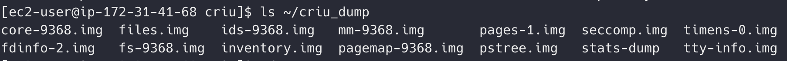
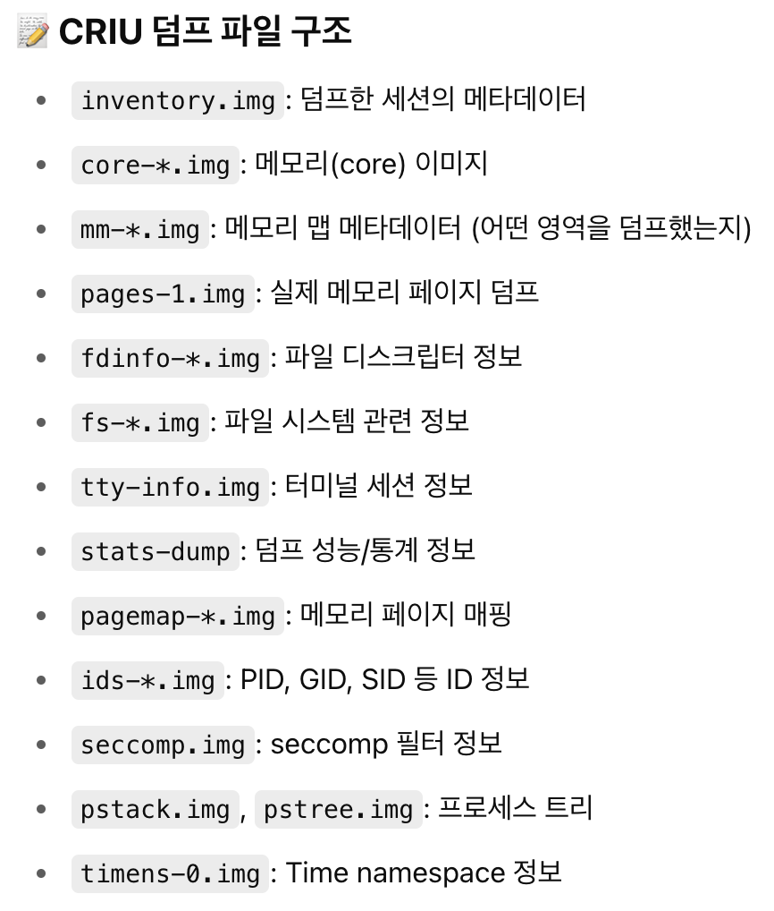
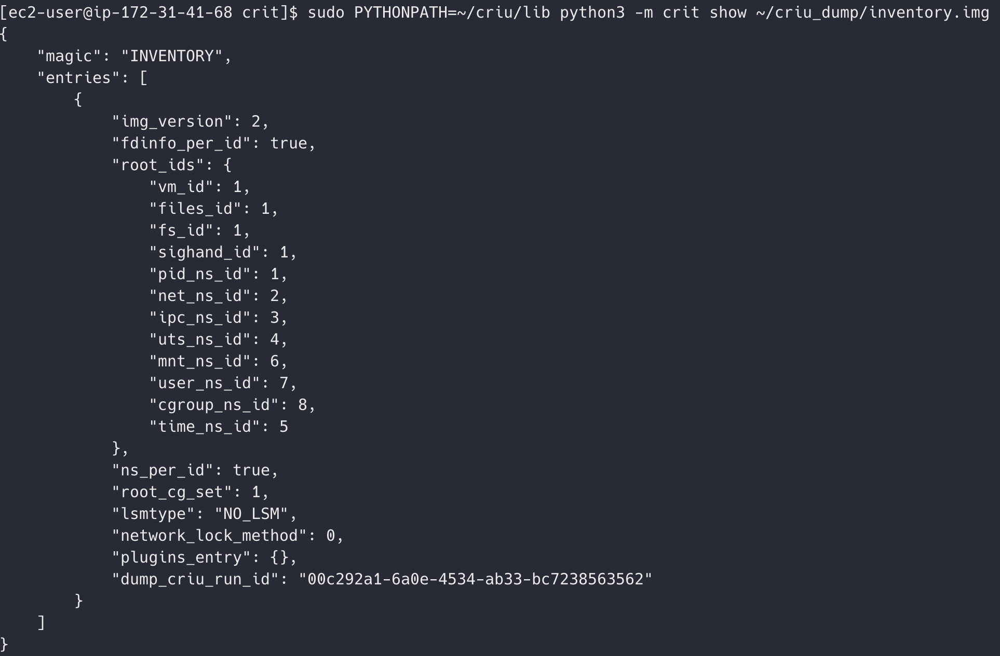
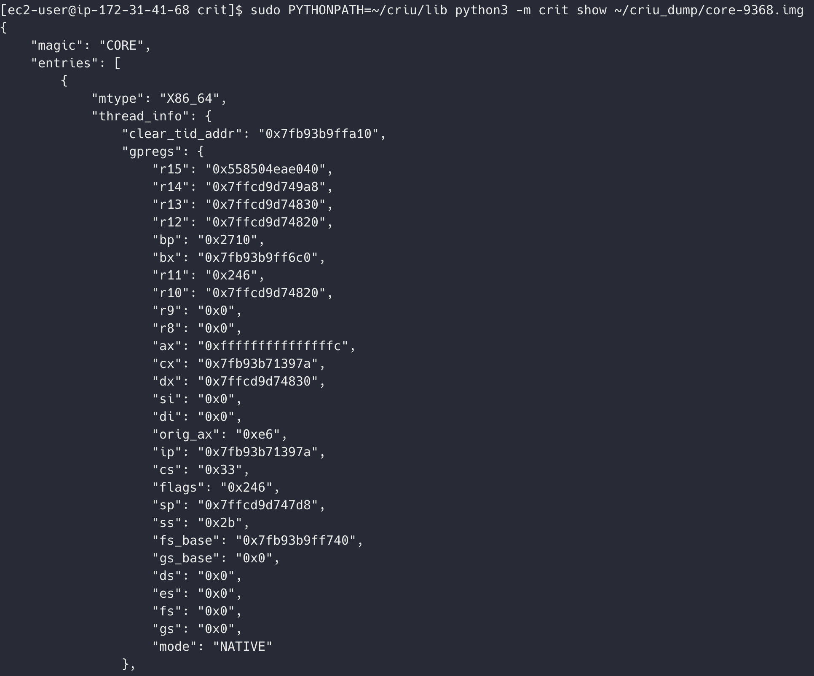

원문: [Notion에서 보기](https://app.notion.com/p/20d3abb1a94d8090aca6cf819a2ec300?pvs=204)

# criu 로 프로세스 덤프

- 교착상태를 해결하기 위한 방법 중 하나로, 프로세스의 상태를 롤백하는 방법이 있다.
- 그럼 롤백한 데이터는 어떻게 생겼을까?
  - 이걸 criu 로 알아보고자 한다
- cf ) 참고로 mac + docker 에서는 criu 안됨!
  - criu 가 동작하기 위해서는 리눅스 커널 내부 깊숙한 곳까지 권한을 가지고 있어야하는데(리눅스 커널 딥 시스템콜 사용하기 위해서), 근데 vm 에서는 이게 안됨
  - 그니까 vm 에서 띄운 리눅스 커널이라서 권한을 다 가지지 못하기 때문에 ! mac + docker 는 criu 안된느 것
    - <b>Q. 근데 vm 이면 오히려 내가 권한 다 가져야 하는 거 아님?</b>
      - VM은 사실 MacOS 커널이 관리하는 가상화 레이어 (Hypervisor.framework, Apple Virtualization Framework) 위에 띄워진 "손님" 리눅스 커널
      - 가상화 시스템은 안정성/보안을 위해 기본적으로 게스트 OS가 호스트 리소스를 직접 컨트롤하는 걸 차단
        - <b>Q. 근데 vm 내부에서 사용하는 시스템콜은 vm 에만 영향 미치는 거 아님? 호스트까지 영향 안 갈 거 같은데 왜 안정성 위해서 막는 거?</b>
          - 가상화 기술은 완벽한 격리를 제공하는 게 아님
          - CPU, 메모리, 디바이스 I/O 같은 하드웨어 자원은 실제로는 호스트 머신과 게스트 머신(VM) 이 나눠서 사용함
          - 그래서 게스트한테 딥한 권한을 주면 게스트 → 호스트로 탈출이 가능해짐. 그래서 막는 거임!

### 설치

- 필요한 의존성 설치

```kotlin
sudo apt update
sudo apt install -y \
    libprotobuf-dev \
    libprotobuf-c-dev \
    protobuf-c-compiler \
    protobuf-compiler \
    python3-protobuf \
    libnl-3-dev \
    libcap-dev \
    uuid-dev \
    libaio-dev \
    python3-yaml
```

- git 에서 다운로드 후 make

```kotlin
git clone https://github.com/checkpoint-restore/criu.git
cd criu
make
```

- 이후에 criu/criu 폴더로 들어가서 ./criu 하면 된다

### 테스트 코드

- cf ) 실행 전에!
  - 요즘 리눅스 커널에는 capability 라는 시스템이 있음
  - 이건 root 랑 다른 권한임. 그래서 root 권한을 가지고 있더라도 따로 capability 가 설정되어야 함
  - capability 를 두는 이유는, 시스템 자원을 직접 조작하는 프로그램은 root 와는 결이 다른 권한이 필요학 ㅣ때문
    - root 는 모든 파일에 접근할 수 있는 권한,
    - capability 는 시스템 콜 중 몇몇 위험한 명령에 필요한 별도 권한
  - 그래서 setcap 으로 ./criu 에 capability 설정을 해줘야 함

  ```kotlin
  sudo apt install libcap2-bin // setcap, getcap 설치
  sudo setcap cap_sys_admin,cap_checkpoint_restore=eip ./criu // ./criu 에 필요한  권한 설정
  getcap ./criu // 권한 잘 설정되었는지 확인
  ```
- pid 확인 후 덤프

```kotlin
sleep 1000 & // 백그라운드에서 sleep 돌림
ps // 여기서 pid 확인
sudo ./criu dump -t [PID] -D [TargetDir] --leave-running --shell-job // 이걸로 덤프
```

- criu 명령어를 뜯어보면
  - 일단 \[PID\] 에 해당하는 프로세스를 덤프해서 \[TargetDir\] 에 저장하고
    - 여기 실제로 폴더 잇어야함
  - 덤프한 다음에 프로세스를 계속 실행 상태로 두기 위해 --leave-running 옵션을 사용함
  - 명령어 맨 뒤에 --shell-job 붙이면 터미널에 붙은 세션도 덤프 가능해짐!
    - criu 는 기본적으로 터미널(tty) 과 연결된 프로세스는덤프 거부함
    - 그래서 sleep 1000 & 처럼 bash 에서 띄운 프로세스는 덤프할 수 없음
    - 왜냐면 터미널 상태 복구가 매우 어렵고 깨지기 쉬워서 그런 것!
    - 그래서  --shell-job 을 붙여주어야 함



- 그럼 이렇게 덤프가 된다!
- .img 파일로 나오는데, 나오는 파일은 아래와 같다고 한다.
  
- criu 설치하면 같이 제공하는 crit 으로 이 파일을 열어볼 수 있다.
- 원래 make 하면 같이 설치되어야 하나, 현재 같이 설치되지 않고 소스코드만 남아있는 상태이므로 직접 빌드한다.

```kotlin
cd ~/criu/crit // criu 폴더 내부의 crit 폴더로 이동
sudo PYTHONPATH=~/criu/lib python3 -m crit show [img_path]
```

- PYTHONPATH
  - crit 를 빌드하기 위해서는 pycriu 라는 패키지가 필요함
  - 근데 얘가 설치가 안된 상태. 얘는 폴더로 criu/lib 내부에 존재함
  - 그래서 PYTHONPATH 로 패키지 경로를 잡아주어야 빌드가 가능!
- 이미지를 확인하면 이런 정보를 얻을 수 있다!!
  

  - 이렇게 메타데이터를 볼 수도 있고!

  

  - 이렇게 프로세스의 <b>레지스터 상태(registers)</b>, <b>스레드/프로세스 컨텍스트를 볼 수도 있다!</b>
  - CPU가 작업 중이던 정확한 상태까지 확인 가능함!
