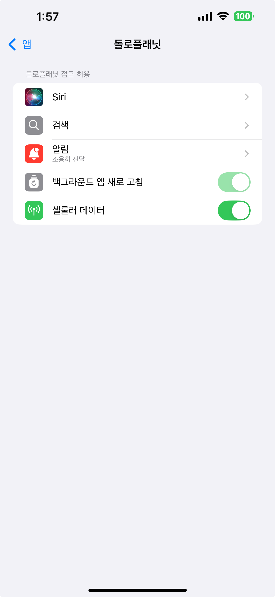
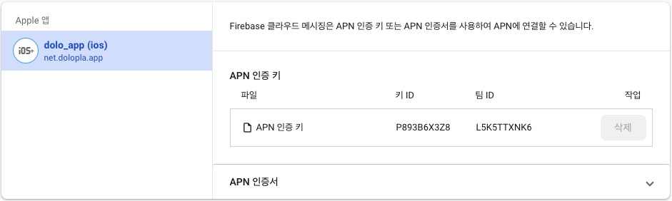
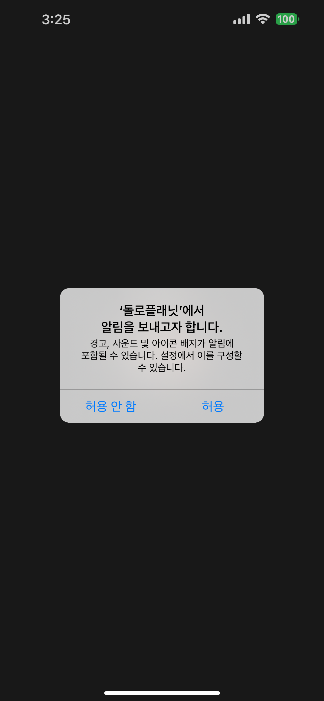
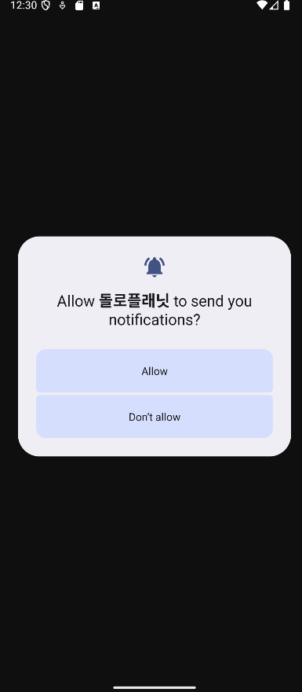
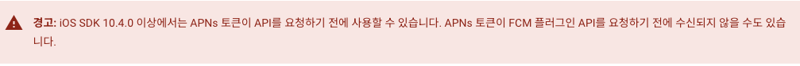
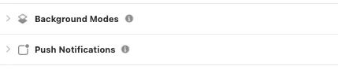
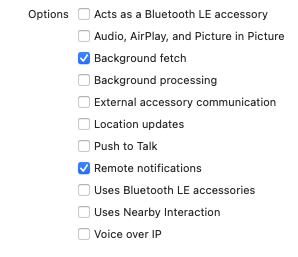

원문: [Notion에서 보기](https://app.notion.com/p/15b3abb1a94d8037b860e3d7a506580f?pvs=204)

# FCM Device Token

요약

1. FCM 사용해서 push message 전송하려면 device Token 필요함
2. Android 하고 iOS 하고 토큰 얻는 방식이 다름. 비교적 iOS 가 복잡함
   1. iOS 에서는 APN 키 등록, <s>알림 권한 획득</s>, APNs 토큰 발급, xcode 설정이 되어야 device Token 가져올 수 있음.

## <br />iOS, Android 공통 (이면 좋은 거. 근데 사실 없어도 된다)

```javascript
if (await Permission.notification.isDenied) {
    var result = await Permission.notification.request();

    if (result.isDenied) {
      return;
    }
  }
```

```javascript
await FirebaseMessaging.instance.requestPermission(
      alert: true,
      badge: true,
      sound: true,
      provisional: false
  );
```

알림 권한 요청은 이거 둘 중에 하나로 할 수 있다!

둘 다 알림 요청 창 띄워줌. iOS에서는 같은 API(UNUserNotificationCenter) 호출함. Android 에서는 각각의 방법이 살짝 다르게 동작하긴 하는데 어쨌든 알림 요청 창 띄워줌!

<b>Q. 어떤 걸 추천하시나용?</b>

iOS랑 Android 개발을 같이 하신다면 후자를 추천함미다!<br />iOS 에서 deviceToken 받으려면 여러가지 추가 설정을 해줘야 하는데, 그 중에 하나를 얘가 해줘요!

(어? 그럼 안드로이드는요? → 얘는 효자라 이런 과정 없어도 디바이스 토큰을 잘 물어온답니다\~)

<br />iOS 에서 deviceToken 을 받기 위해서는 먼저 APNsToken 이라는 게 생성되어야 해요!<br />APNsToken 생성을 요청하기 위해서는 AppDelegate.swift 에서 <code>application.registerForRemoteNotifications()</code> 이걸 호출해야 합니다.<br /><code>requestPermission</code> 이 친구는 내부적으로 <code>application.registerForRemoteNotifications()</code> 을 호출하도록 설계되어있습니다! 짱 편하겠죠?

<b>Q. provisional 옵션이 뭔가요?</b>

이건 iOS 에만 적용되는 옵션이에요! (Android 에서는 알아서 걸러짐)

iOS 는 알림 받는 방식 중에 ‘조용히 전달’ 이라는 게 있습니다.

provisional 이 true 일 경우에는

1. 디바이스 토큰 받아오고 (이건 <code>requestPermission</code> 때문에 되는 거긴 해요! false 여도 디바이스 토큰은 받음)
2. 알림 요청 창 안 띄우고
3. 조용히 전달로 설정합니다.

사용자 경험을 개선(알림 권한 요청 창 안 띄우고 싶을 때) 사용합니다.



<b>Q. 그럼 왜 공통이면 좋은 건가용 ?</b>

아이폰에서는 알림 권한이 있어야 디바이스 토큰을 받아올 수 있기 때문에 꼭 이게 필요한데, 안드로이드는 아닙니다… 그러나!! 우리는 push 를 띄우기 위해서 알림 권한을 요청해야 할 때가 분명히 있습니다!! 위 코드들은 iOS, Android(API 33 이상) 에서 알림 요청 창을 띄워주기 때문에! 공통으로 구현해두면 나중에 알림 권한 요청을 따로 또 구현할 필요가 없어지게 되는 것입니다!!

<b>Q. 선생님 저 </b><b><code>FirebaseMessaging.instance.requestPermission</code></b><b> 사용했는데, 알림 요청 창이 안 떠요ㅜ</b>

→ 모달 안 보이는 이유는 provisional 설정 때문에 그래요\~ 위에 적어둔 걸 보세용

provisional 이 true 인 경우, 알림 요청 안 하고 이렇게 ‘조용히 전달’으로 설정됨!

<b>Q. 이거 두 가지 모두 사용하면 어떻게 되나요?</b>

아이폰, 안드로이드 모두 둘 다 쓰면 하나만 띄워줘요

iOS 시스템에서 같은 API 치는 거 확인하면 이전에 응답한 값 가져와서 사용함니다.

뭐 안드로이드도 비슷하게 동작하는 것 같아요\~

## <b>\*\* 아이폰은 까다롭다!</b>

iOS 는 추가적인 설정을 더! 해야 토큰을 받을 수 있다.

1. <b>APN 인증서를 등록해줘야 한다.</b>
   

FirebaseConsole - 프로젝트 설정 - 클라우드 메시징 탭에서 APN 인증 키를 등록해줘야 한다.

발급받는 방법은 다른 사람들이 친절하게 알려주고 있음!

2. <s><b>알림 권한 있어야 토큰 받아올 수 있다.(위에서 공통으로 설명한 부분)<br /></b></s><b>이거 말고 </b>[<b>자자 집중해주세요</b>](/15b3abb1a94d8037b860e3d7a506580f?pvs=25#15d3abb1a94d80558669e7a1fc8a9c15)<b> 부분을 봐주세용</b>

```javascript
if(await Permission.notification.isDenied) {
    var result = await Permission.notification.request();

    if(result.isDenied) {
      return;
    }
  }
```

```javascript
await FirebaseMessaging.instance.requestPermission(alert: true, badge: true, sound: true, provisional: false);
```

\*둘 다 같은 API (UNUserNotificationCenter) 호출하기 때문에, 둘 중에 원하는 거 하나 사용하면 된다.

이 코드는 알림 요청 창을 띄우는 코드이다. (아이폰에서는 무조건 띄움, 안드로이드에서는 API 33 이상에서만 띄움, 그 이전 버전에서는 기본적으로 알림 허용 돼있어서 이 창 안 뜨고 넘어감)



아이폰



안드로이드(API 33 이상)

\*33 이전 버전에서는 이렇게 해도 알림창 안 뜸

안드로이드는 알림 허용 여부와 관계 없이 디바이스 토큰 가져올 수 있는데, 아이폰은 권한 설정이 안되면 가져올 수가 없다.

디바이스 토큰은 이렇게 가져온다.

```javascript
String? fcmToken = await FirebaseMessaging.instance.getToken();
```

(권한 설정 안되면 아이폰은 토큰 가져올 수가 없음 ㅜ)

<h2>
자자 집중해주세요\~ 
</h2>

저도 처음엔 이게 있어야 디바이스 토큰을 받을 수 있는 줄 알았답니다.

그런데..! 그게 아니었어요! 알림 요청을 해야 디바이스 토큰을 받을 수 있다! 이게 아니라,

<b><code>requestPermission</code></b><b> 방식으로 알림 요청을 하면! APNsToken 생성 요청을 날릴 수 있다!!</b>

이게 올바른 말이랍니다\~

헷갈린다구요? 하나씩 설명해드릴게요\~

아이폰에서 deviceToken 을 받기 위해서는 APNsToken 이라는 게 미리 생성되어 있어야 합니다.

근데 이게 하늘에서 뚝! 하고 떨어질 리가 없죠?

우리가 만들어줘\~ 하고 요청을 해야 해요.

근데 얘가 친구를 가려서, 만들어졌다고 flutter 한테는 안 해주고, swift 한테만 해줍니다.

그래서 우리가 getToken() 을 했을 때 “<b>APNsToken 이 없어서 못 만들겠어 ㅠ” </b>하는 경우가 종종 생깁니다.

이걸 해결하는 방법은 아래에 적어둘게요!

[Notion 참조 블록: 원문에서 보기](https://app.notion.com/p/15b3abb1a94d8037b860e3d7a506580f#15d3abb1a94d80c0961eda91867b7100)

3. <b>getToken() 하기 전에 APNsToken 이 준비되어야 한다.</b>



이건 이런 뜻이라고 한다

> IOS SDK 10.4.0 이상에서는 <b>APNs 토큰이 비동기적으로 생성</b>되기 때문에, FCM 플러그인의 API가 APNs 토큰을 필요로 할 경우, APNs 토큰이 아직 생성되지 않았을 가능성이 있습니다. 따라서 FCM 토큰을 요청하는 타이밍에 따라 FCM 토큰이 없거나 APNs 토큰 없이 동작할 수 있다는 뜻입니다.

 이게 왜 중요하냐면 <b>아이폰의 device 토큰은 APNs 토큰에 기반하여 생성</b>되기 때문이다

그래서 이렇게 APNs 토큰이 생성되었는지 먼저 확인하고, getToken() 해야한다.

```javascript
 if (Platform.isIOS) {
    await FirebaseMessaging.instance.getAPNSToken();
  }
 deviceToken = await FirebaseMessaging.instansce.getToken();
```

→ 근데 이걸로는 부족하다!

이건 그냥 APNs Token 을 받아오는 거임! 우리는 생성이 비동기로 이뤄지기 때문에, 생성이 다 됐는지를 체크해야함

\*참고

- APNs 토큰이 필요한 이유는, 아이폰에서 FCM device 토큰을 만들 때 APNs 토큰을 기반으로 만들기 때문이다.
- APNs 는 앱마다 고유하게 생성된다.
- FCM 에서 deviceToken 을 생성하기 위해 호출하는

만약에 이렇게 안 하면 이런 에러가 뜰 수 있다. (비동기 처리이기 때문에 안 뜰 수도 있고 뜰 수도 있음)

<code>firebase_messaging/apns-token-not-set] APNS token has not been set yet. Please ensure the APNS token is available by calling `getAPNSToken()</code> 

참고로, firebase console 에 APN 인증서 등록해둬도 이 과정은 거쳐야 함. 인증서를 등록한 이유는 APNs 서버와의 연결을 위한 거임. APNs 토큰 발급이 비동기적으로 이뤄지기 때문에 iOS 에서 fcm device 토큰 받으려고 할 때는 APNs 토큰이 생성되었는지 체크해야함.

4. <b>xcode 에서 권한 설정해줘야 한다.</b>
   

두 권한이 모두 설정되어야 한다.

Background Modes 의 경우 옵션이 이렇게 체크되어야 한다.



이거 안되어있으면 3번까지 해도 APNs Token 을 가져올 수 없다는 에러 뜬다!
