원문: [Notion에서 보기](https://app.notion.com/p/17b3abb1a94d80d1bd0ddaf37a2487e9?pvs=204)

# 대 참 사(였던 것)

물론 형선님께서 해결해주시긴 했지만!

### 시간 여행은 가능한가?

스티븐 호킹은 ‘시간 여행자를 위한 파티’ 를 열어 시간 여행이 불가능함을 실험적으로 보였다.

이 실험이 의의를 갖기 위해서는 하나의 전제가 필요한데, 바로 ‘시간 여행자가 파티에 참여할 의향이 있다’ 는 것이다.

만약에 내가 시간 여행자라면? 관심 받는 것을 싫어하는 나는 파티에 가지 않았을 것이다. 

그러나 내 의사와는 관계 없이 얼마 전 ‘시간 여행자를 위한 파티’ 에 참석당하고 왔다.

파티 장소는 ‘git’, 주체자는 나였다.

### 얼마 전, 아무도 모르지만 아주아주 큰일!(이 될 뻔한 것) 이 있었다.

바로! server 작업 내용이 날아간 것!

feature 브랜치에서 구글 로그인을 구현한 나는 기계적으로 코드를 적었다.

```javascript
git push -f origin devleop (으악)
```

\*commit amend 를 했기 때문에 force push 를 사용하였었다.

문제는 원래 push 해야 할 브랜치가 아니라 develop 으로 바로 push 해버린 것!

(git 에서는 다른 브랜치로의 push 를 제한하지 않는다.

다른 브랜치로 push 를 하고 싶다면 이렇게 작성하면 된다.

```javascript
git push <remote> <source branch>:<dest branch> 
```

근데 내가 적은 명령어는 이도 저도 아닌 명령어였다.)

<b>Q. 근데 이게 왜 큰일이에요? rebase 받았으면 어차피 develop 변경 사항이 해당 커밋에 담겨 있을 거고, 그 상태에서 push 하면 결과적으로 새로운 기능만 추가된 거 아닌가요?</b>

→ rebase 는 받았습니다! 근데 develop 브랜치가 옛날 상태로 돌아갔어요

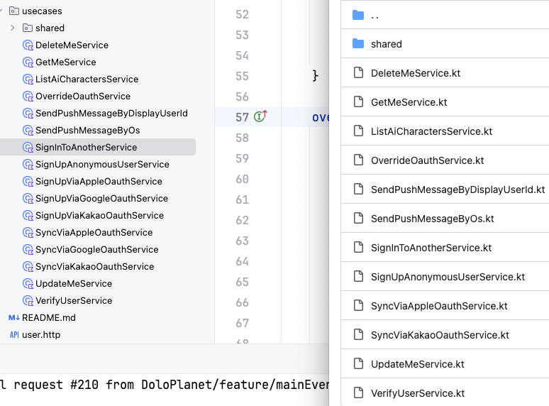

(왼쪽 : 작업한 브랜치, 오른쪽 : develop 브랜치. <br />rebase 를 받은 작업 브랜치에서 보이는 변경 사항이 develop 브랜치에서 보이지 않는다.<br />시간 여행이 분명하다..)

<b>Q. 왜요?</b>

→ 몰라요

형선님께서 해결해주신 덕분에🙇‍♂️ 마음은 놓았지만, 도대체 내가 무슨 짓을 저지른 건지에 대한 궁금증이 생겼다.

그래서 한 번 테스트 해보기로 했다.

## 설계

test repository 를 만들어 테스트 해보자

dol-271 브랜치는 develop 브랜치에서 파생된 브랜치였고, develop 브랜치에는 새로운 커밋이 쌓인 상태였다.

여기서는 서로 다른 두 개의 브랜치(<span color="red">origin</span>, <span color="blue">new. new</span> 는 <span color="red">origin</span> 에서 파생)를 생성하고, <span color="blue">new 브랜치</span>에서 <span color="red">origin 브랜치</span>로 force push 해보도록 하겠다.

이런 상태를 만들고 테스트하고자 한다. 

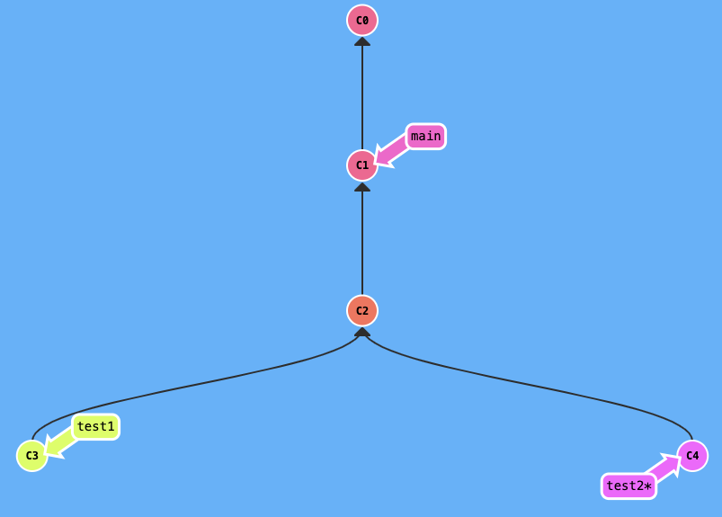

- <span color="red">test1</span> : c1(시작점) - c2 - c3
- <span color="blue">test2</span> : c2(시작점) - c4
- 테스트 : <span color="blue">test2 브랜치</span>에서 새로운 커밋을 만들고 <span color="red">test1 브랜치</span>로 force push

<details markdown="1">
<summary>테스트 과정</summary>

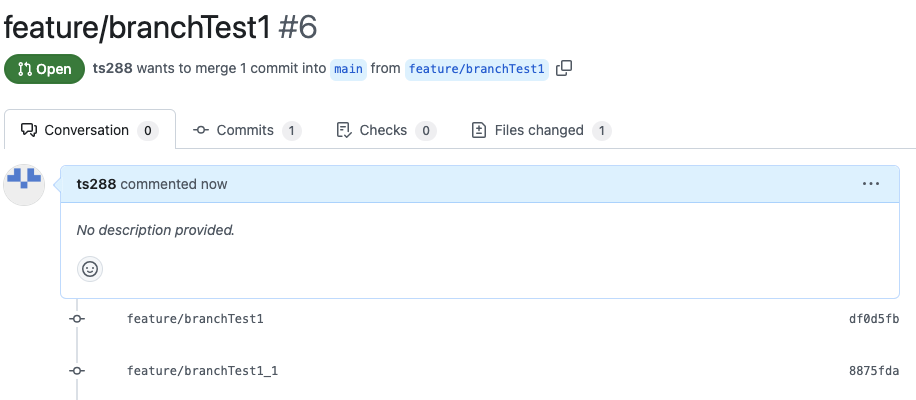

<span color="red">test1 브랜치</span>를 생성하고, 두 개의 커밋을 추가해두었다.

<span color="blue">test2 브랜치</span>의 파생 시점을 첫 번째 커밋 시점으로 정하기 위해 첫 번째 커밋으로 이동한 후 (<code>git reset —hard df0d5fb</code>), <span color="blue">test2 브랜치</span>를 생성하고 <span color="blue">test2 브랜치</span>에서 <span color="red">test1 브랜치</span>로 force push 해보도록 하겠다.

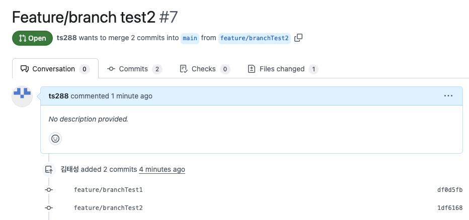

<b><span color="blue">test2 브랜치</span></b><b>는 df0d5fb 에서 파생된 브랜치이기 때문에 df0d5fb 커밋을 들고 있는 것</b>을 확인할 수 있다.

([<b><span color="pink">새로운 브랜치를 생성</span></b>](/17d3abb1a94d80d8ab35caca5c0b61e1?pvs=25)하면 파생 시점의 기존 브랜치 커밋을 복사해서 들고 있게 된다.)

<span color="blue">test2 브랜치</span>에 새로운 커밋을 만들고, 이 커밋을 <span color="red">test1 브랜치</span>에 force push 하면 이렇게 뜬다.

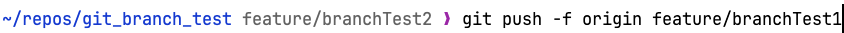

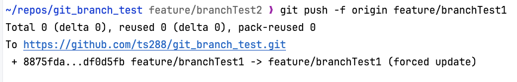

<b>8875fda 커밋에서 df085fb 커밋으로 수정</b>됐다는 것을 확인할 수 있다.

각 커밋은 <span color="red">test1 브랜치</span>의 두 번째, 첫 번째 커밋이다.

그러니까, <span color="red">test1 브랜치</span>의 상태가 <b>첫 번째 커밋만 추가된 상태로 돌아갔다는 것!</b>

실제로 확인해보면 이렇다.

커밋을 두 개 추가해 두었던 <span color="red">test1 브랜치</span>의 변경 사항이

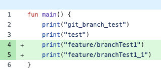

이렇게 변했다!

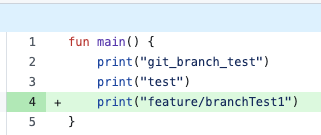

git 에도 이렇게 변해있는 것을 확인할 수 있었다.

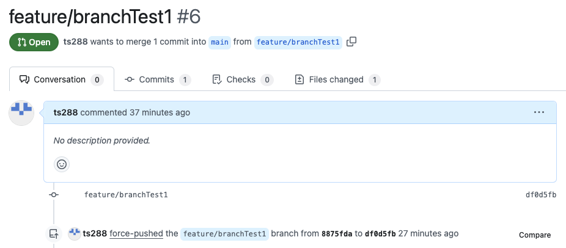

</details>

## 결과

<span color="blue">test2 브랜치</span>에서 새로운 커밋을 만들고 <span color="red">test1 브랜치</span>로 force push 하니 <b><span color="blue">test2 브랜치</span></b><b>가 파생된 시점(c2)으로 </b><b><span color="red">test1 브랜치</span></b><b>가 변경</b>되었다!

## 가정

그럼 이 시점에서 가설을 하나 세워볼 수 있을 것 같다.

<b>전제 :</b><b><span color="red"> </span></b><b><span color="blue">new 브랜치</span></b><b>가 </b><b><span color="red">origin 브랜치</span></b><b>에서 파생<br />가설 : </b><b><span color="blue">new 브랜치</span></b><b>에서 </b><b><span color="red">origin 브랜치</span></b><b>로 force push 를 할 때 올바른 명령어가 아니면,  </b><b><span color="blue">new 브랜치</span></b><b>가 파생된 시점의 커밋으로 </b><b><span color="red">origin 브랜치</span></b><b>가 업데이트 된다.</b>

## 설계

이전 테스트에서는 <span color="red">test1 브랜치</span>에 커밋을 두 개 쌓고 첫 번째 커밋에서 <span color="blue">test2 브랜치</span>를 생성했다.

이번엔 <b><span color="red">test1 브랜치</span></b><b>에 커밋을 세 개 쌓고 두 번째 커밋에서 </b><b><span color="blue">test2 브랜치</span></b><b>를 생성</b>해서 force push 를 해보자.

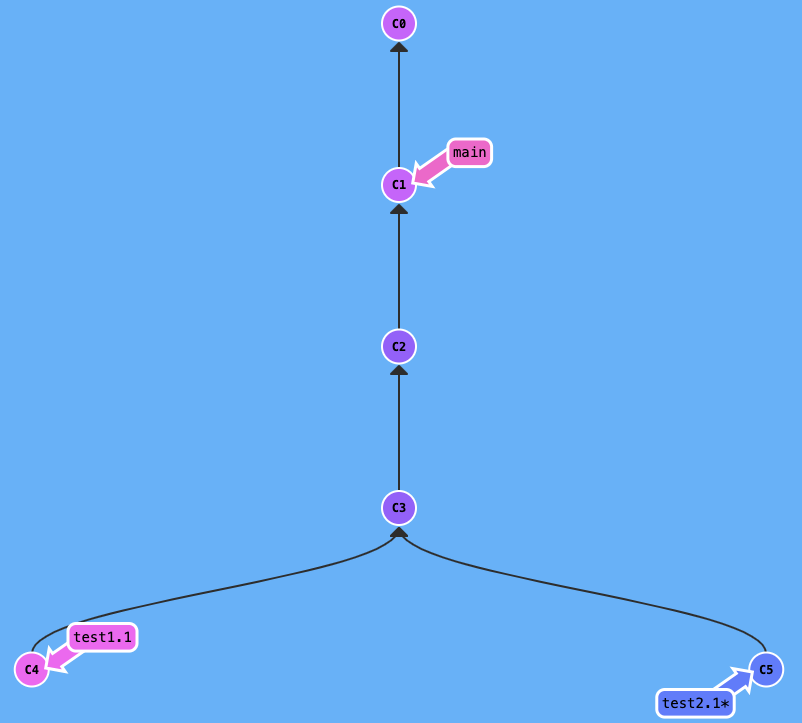

- <span color="red">test1.1</span> : c1(시작점) - c2 - c3 - c4
- <span color="blue">test2.1</span> : c3(시작점) - c4
- 테스트 : <span color="blue">test2.1 브랜치</span>에서 새로운 커밋을 만들고, <span color="red">test1.1 브랜치</span>로 force push
- 예상 : <span color="red">test1.1 브랜치</span>의 상태가 c3 로 회귀

<details markdown="1">
<summary>테스트(두 번째 커밋에서 파생) 과정</summary>

<span color="red">test1.1 브랜치</span>를 생성하고 세 개의 커밋을 쌓았다.

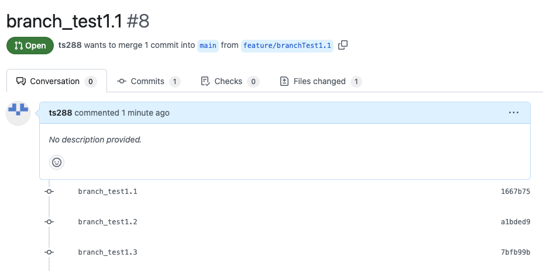

<code>git reset --hard a1bded9</code>

<code>git checkout -b feature/branch_test2.1</code> 

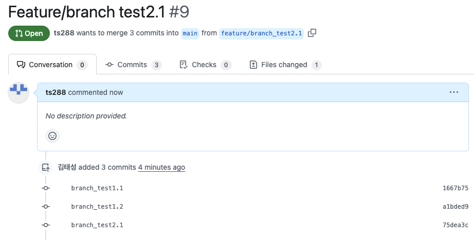

<span color="red">test1.1</span> 커밋에서 <span color="blue">test2.1 브랜치</span>를 만들었기 때문에, <span color="red">test1.1 브랜치</span>의 1.2 까지의 커밋이 함께 온 것을 확인할 수 있다.

이제 <span color="blue">test2.1 브랜치</span>에 새로운 커밋을 추가하고 <span color="red">test1.1 브랜치</span>에 force push 를 하면!

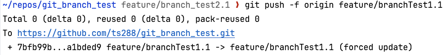

<b>7bfb996 커밋에서 a1bded9 커밋으로 </b><b><span color="red">test1.1 브랜치</span></b><b>가 수정</b>된 것을 확인할 수 있다.

각각의 커밋은 <span color="red">test1.1 브랜치</span>의 1.3 커밋, 1.2 커밋이다.

<b>즉, </b><b><span color="red">origin 브랜치</span></b><b>는 </b><b><span color="blue">new 브랜치</span></b><b>가 파생된 시점의 상태로 돌아오게 되었다!</b>

git 에서 확인해보면 다음과 같이 보인다.

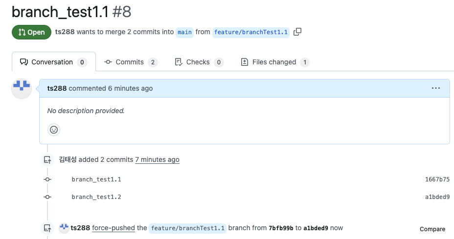

</details>

## 결과

예상대로 <span color="red">test1.1 브랜치</span>는 <span color="blue">test2.1 브랜치</span>가 파생된 시점인 c3 상태로 회귀한 것을 확인할 수 있었다.

<b>그런데 이게 </b><b><span color="blue">new 브랜치</span></b><b>가 </b><b><span color="red">origin 브랜치</span></b><b>에서 파생된 시점으로 회귀하는 것인지, </b><b><span color="blue">new 브랜치</span></b><b>가 가지고 있는 가장 최신의 </b><b><span color="red">origin 브랜치</span></b><b> 커밋으로 회귀하는 것인지는 모르겠다.</b>

이걸 확인하려면 [<b><span color="pink">rebase</span></b>](/17d3abb1a94d8081a4b9f847b2283844?pvs=25) 해보면 될 것 같다.

<details markdown="1">
<summary>테스트(rebase) 과정</summary>

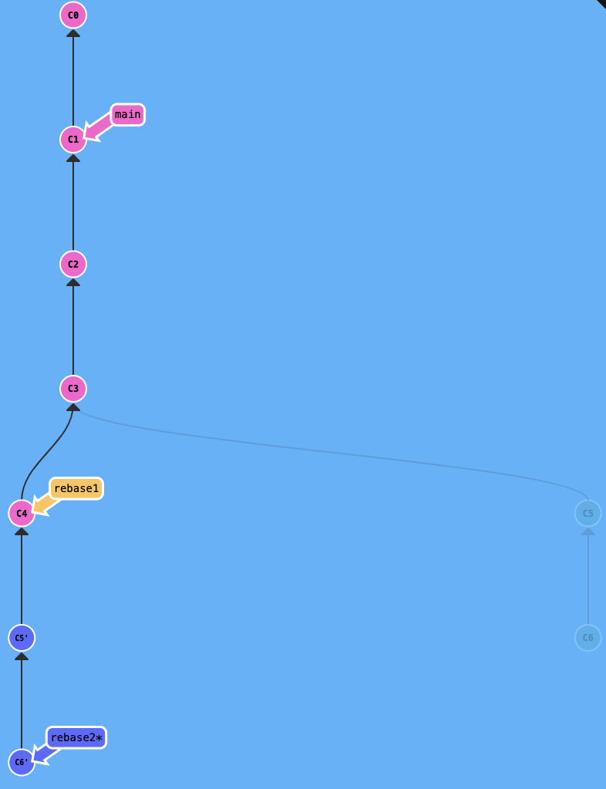

- <span color="red">rebase1</span> : c1(시작점) - c2 - c3 - c4
- <span color="blue">rebase2</span> : c3(시작점) - c5 - c6
- rebase → <span color="blue">rebase2</span> : c1 - c2 - c3 - c4 - c5’ - c6’
- 테스트 : <span color="blue">rebase2 브랜치</span>에서 <span color="red">rebase1 브랜치</span>로 force push

<span color="red">rebase1 브랜치</span>에 커밋을 세 개 쌓았다.

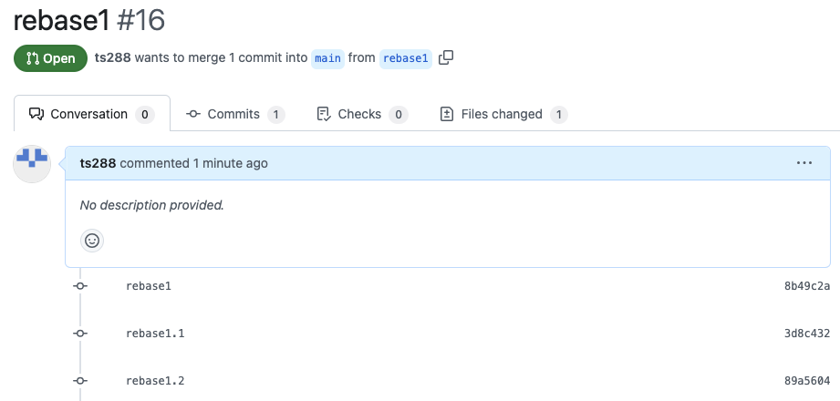

<code>git reset --hard 3d8c432</code>

<code>git checkout -b rebase2</code> 

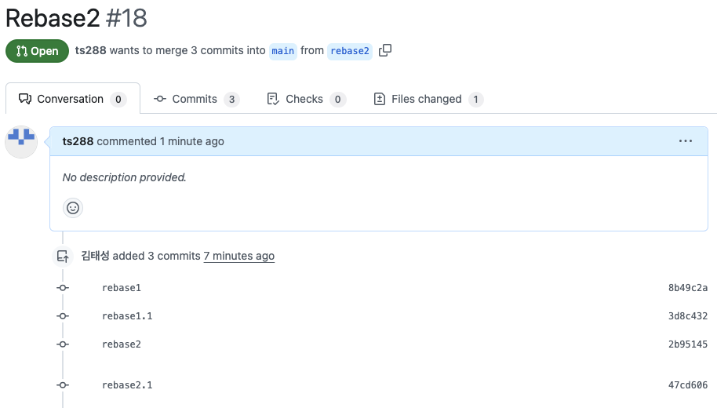

<code>git pull rebase origin rebase1</code> 

(왼쪽 : origin 의 rebase2, 오른쪽 : local 의 rebase2.

rebase 가 완료된 상태라 커밋 해시가 달라진 것을 확인할 수 있다)

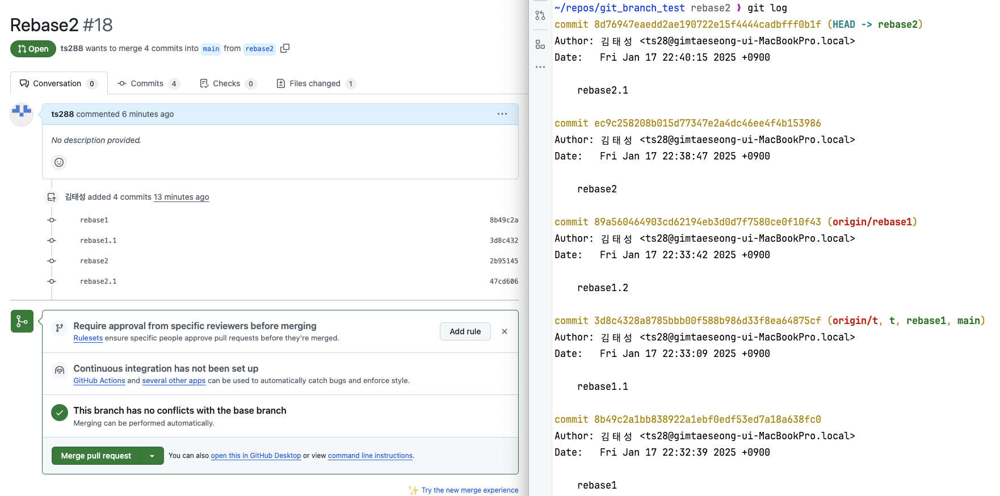

커밋을 추가하고 force push 로 올리니까 바뀐 커밋 해시로 올라간 모습

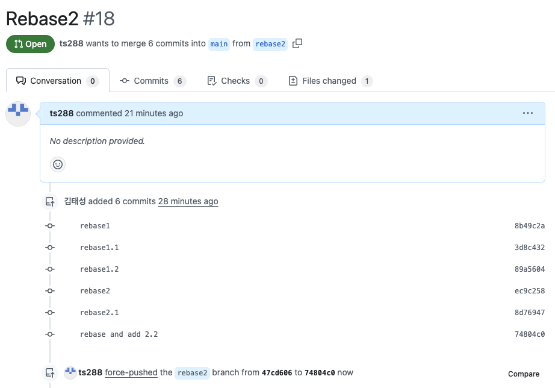

이제 <span color="blue">rebase2 브랜치</span>에서 <span color="red">rebase1 브랜치</span>로 force push 를 하면!

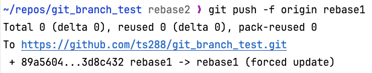

<b><span color="blue">rebase2 브랜치</span></b><b>가 파생된 시점인 3d8c432 상태로 </b><b><span color="red">rebase1 브랜치</span></b><b>가 회귀한 것을 확인할 수 있다!</b>

git 에서 확인하면 이렇게 보인다.

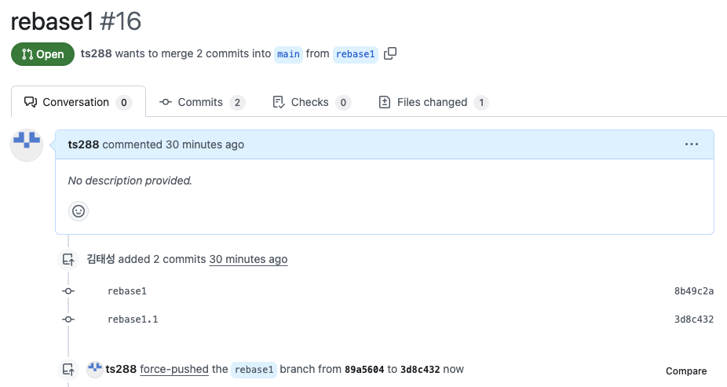

</details>

## 결론

<span color="blue">new 브랜치</span>가 <span color="red">origin 브랜치</span>에서 파생된 상황에서, <span color="blue">new 브랜치</span> → <span color="red">origin</span> <span color="red">브랜치</span>로 force push 하면 <span color="blue">new 브랜치</span>가 <b>파생된 시점</b>으로 <span color="red">origin 브랜치</span>가 회귀한다!

---

흠.. 그런데 내가 겪은 상황에서는 브랜치가 파생된 시점이 아니라 rebase 받은 시점으로 돌아갔다.

이건 나중에 시간을 더 써서 알아봐야 할 것 같다!

일단은! 분석은 여기까지! 이제 일 해야 한다.. 눈치보임..👀

<details markdown="1">
<summary>미해결(왜그럴까)</summary>

테스트하다가 force push 를 했을 때 everything up to date 라고 뜨는 경우가 있었다.

1. new 브랜치를 origin 브랜치의 최신이 아닌 커밋에서 생성 - new 브랜치에서 origin rebase - origin 에 커밋 추가 - new 에 커밋 추가하고 origin 으로 push 한 경우
2. new 브랜치가 origin 브랜치에서 파생되지 않은 경우

이 두 가지는 나중에 시간을 갖고 더 살펴보아야겠다.

</details>

<details markdown="1">
<summary>분석(나중에 더 살펴보기)</summary>

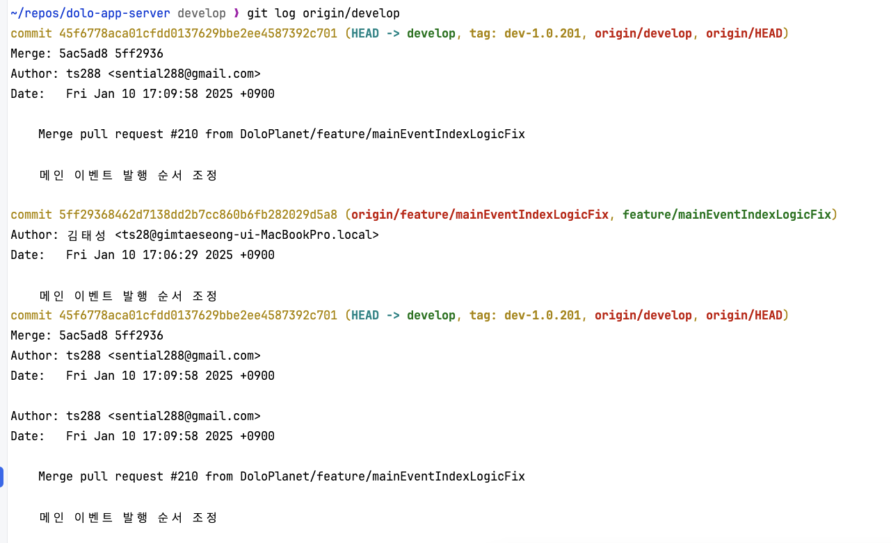

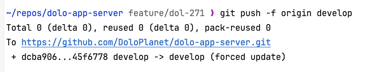

<b>45f6778 에는 아래 사진에 보이는 파일이 없음. 저건 그 다음날에 추가된 거라, 45f6778 로 돌아갓다면 없는 게 맞음</b>

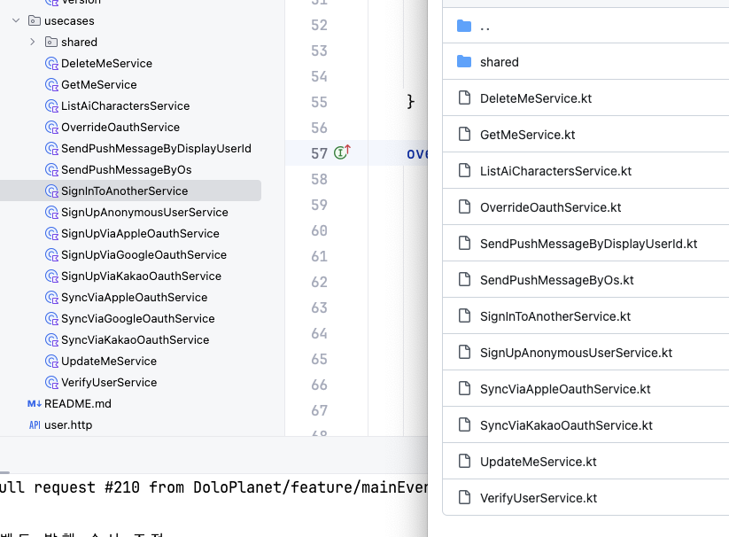

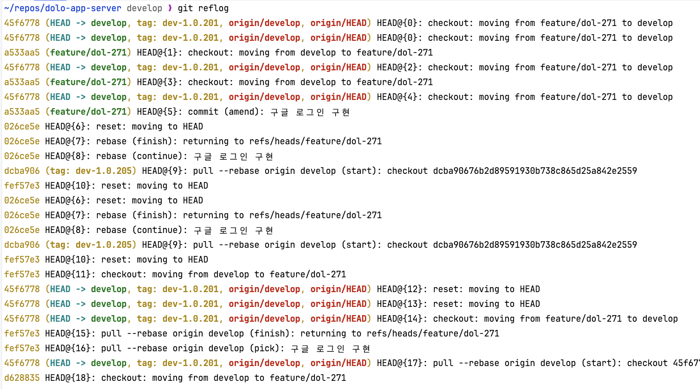

이게 dol-271 브랜치 파생 시점

7748246 (tag: dev-1.0.158) HEAD@\{293\}: checkout: moving from develop to feature/dol-271

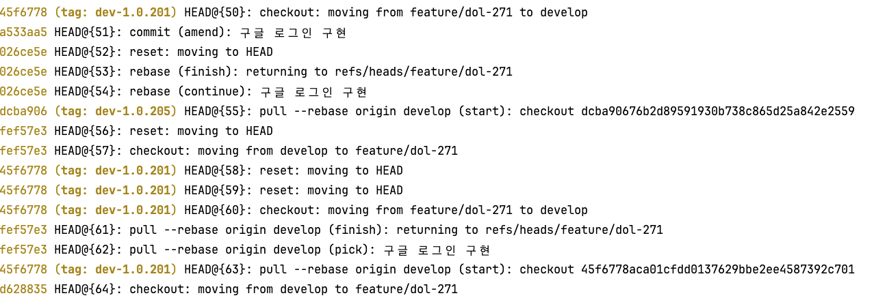

rebase 두 번 (그 사이에 메인 업데이트 됨) - commit amend - push -f

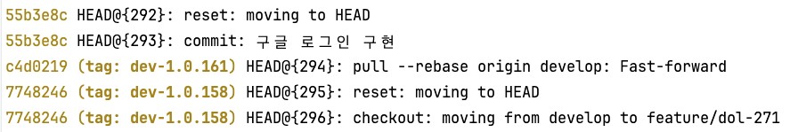

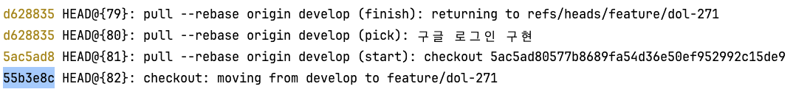

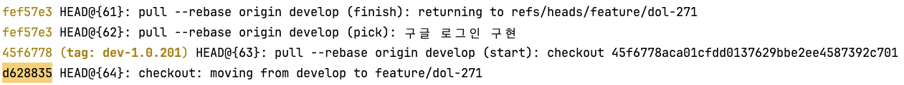

</details>

<details markdown="1">
<summary>추가 테스트(정리 x)</summary>

<details markdown="1">
<summary>rebase 하고 amend 까지 하면 달라질까? 해서 해 본 테스트</summary>

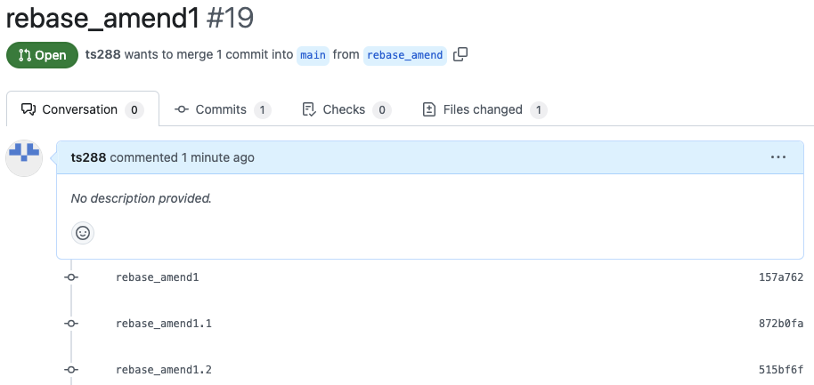

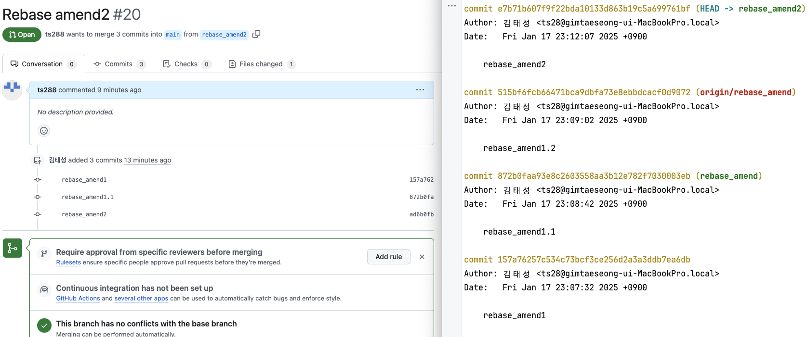

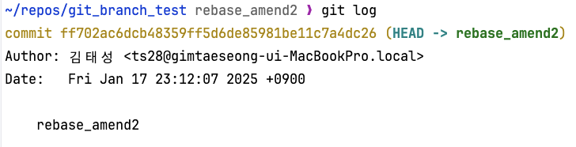

</details>

<h3>
결론 
</h3>

이전과 동일하게 파생 시점으로 회귀

<details markdown="1">
<summary>미해결에 적어둔 테스트</summary>

(new 만들고 origin rebase 받은 다음에, origin 에 커밋 추가하고 force push)

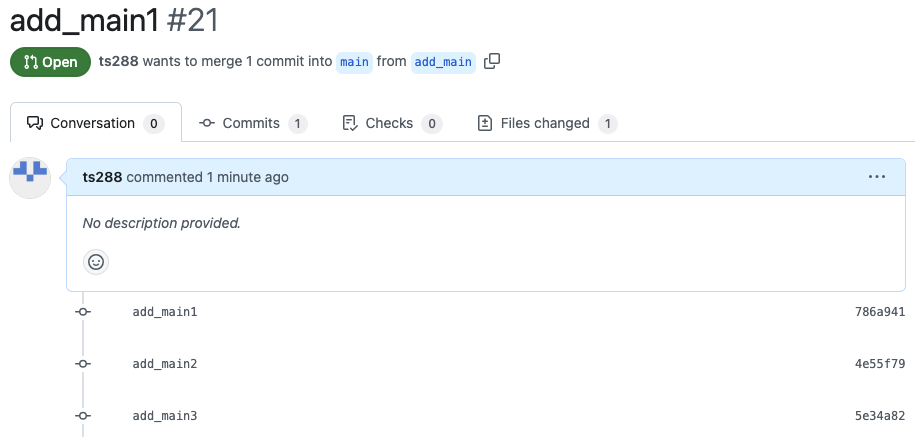

</details>

### 결론

이러면 everything up to date 뜨면서 push 안됨

<details markdown="1">
<summary>new 브랜치가 origin 브랜치에서 파생되지 않은 경우 테스트</summary>

설계

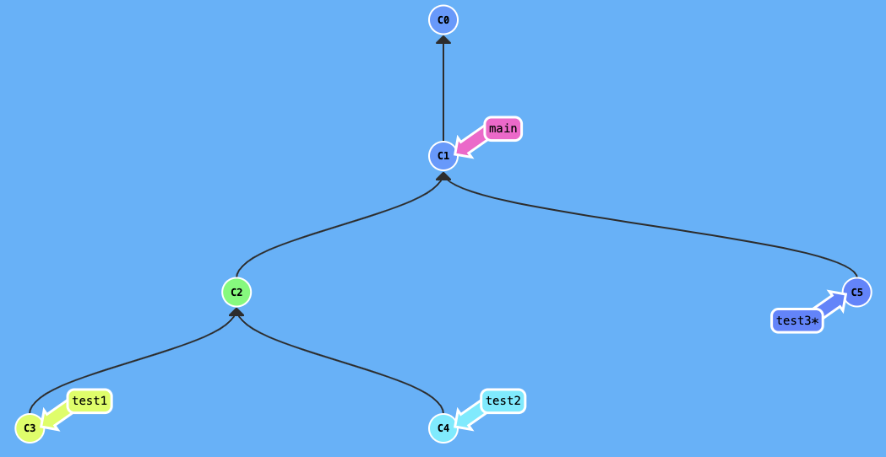

- c2, c3 는 test1 브랜치
- c4 는 test2 브랜치(test1 브랜치의 c2 에서 파생)
- c5 는 test3 브랜치(main 브랜치에서 파생)

test3 브랜치를 test2 브랜치로 force push 한다면?

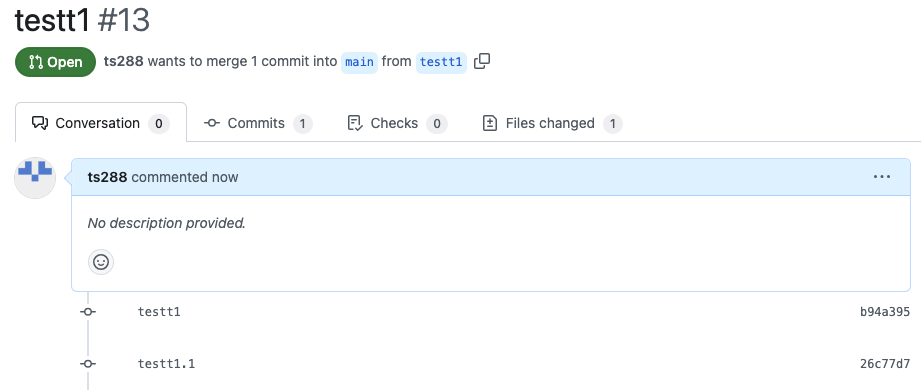

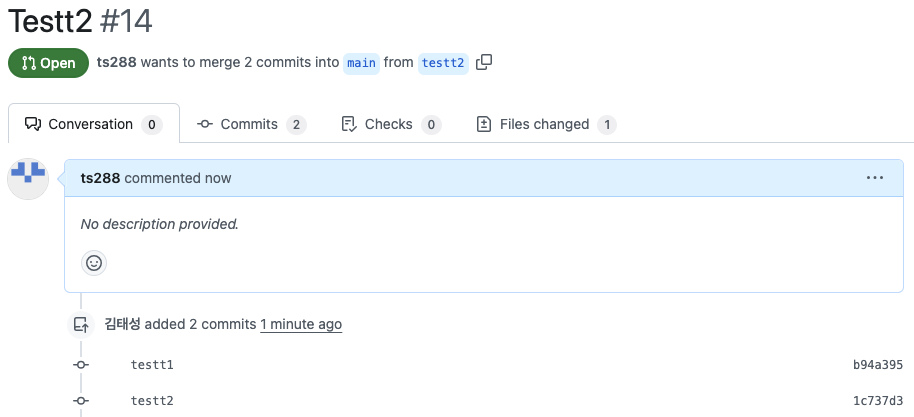

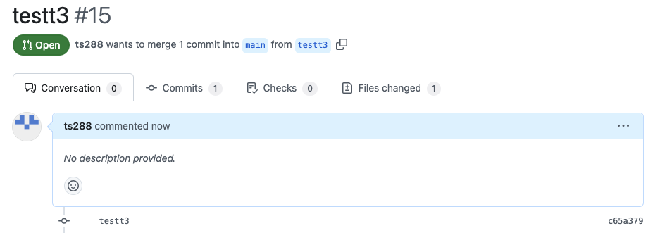

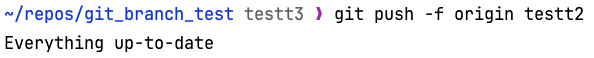

</details>

### 결론

이러면 everything up to date 뜨면서 push 안됨

</details>

---

### <b>그럼 어떻게 해결해야 하는가?</b>

이건 형선님께서 정리해주셨다! (감사합니다🙇‍♂️)

> 제가 했던 방법
>
> - Main 브랜치에 커밋들 남아 있는 거 확인
> - develop 커밋을 main 기준으로 rebase (develop 브랜치에서 git rebase main)
> - develop 브랜치 force push (git push -f)
>
> 태성님 기준에서 해결할 수 있었던 방법
>
> - git reflog 로 찾아본 건 잘했어요 👍
> - 문제 지점으로 하드 리셋 git reset --hard dcba906 // 여기가 아마 dol-271 브랜치 였을 거 같은데
> - dol-271 브랜치에서 develop 에 있는 커밋들 pull rebase (git pull --rebase origin develop)
> - 여기서 conflict 났을 건데, rebase 중간에 컨플릭 난 거기 때문에 git add 한 다음에 commit --amend 하는게 아니라 rebase --continue 해야 함
> - remote 에 있는 dol-271에다가 푸시 (git push)
> - dol-271 을 develop 에 머지하는 PR 생성

### <b>추가로 이런 방법도 고려해볼 수 있다.</b>

- develop 으로 바로 push 하는 것을 막아두는 것
  - 이건 git hub 설정에서 가능
  - setting - rules - rulesets
    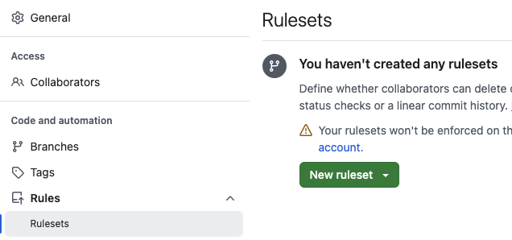
  - new ruleset 에서 branch ruleset 선택하고 ‘Require a pull request before merging’ 체크 <br />(이외에도 다양한 rule 추가 가능하니 유용하게 사용하자!)
    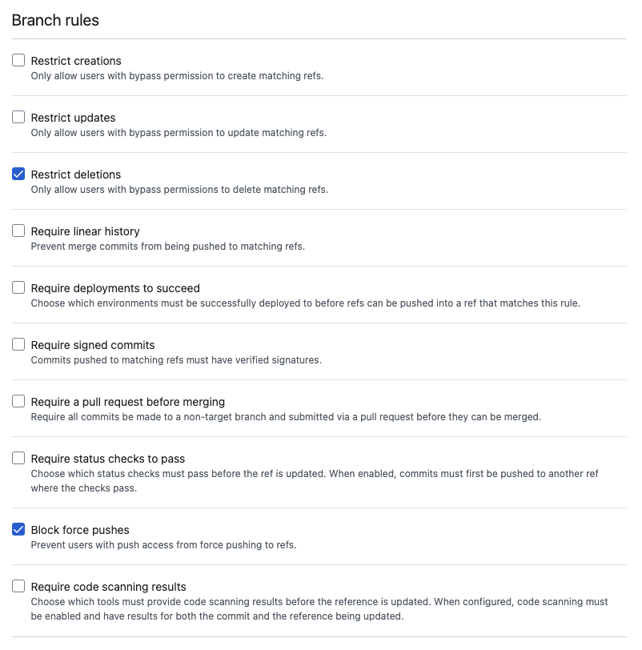
