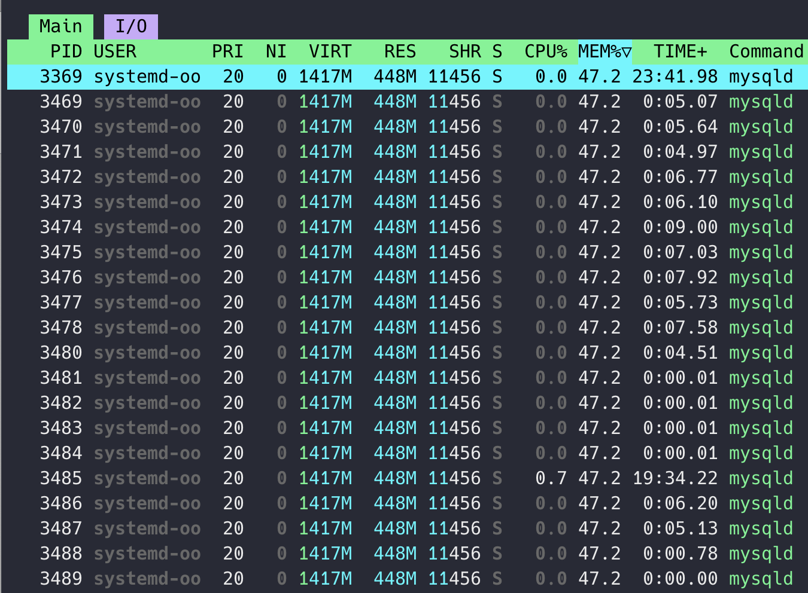

원문: [Notion에서 보기](https://app.notion.com/p/1e73abb1a94d80468040c350f61f9cad?pvs=204)

# 몰라도 되지만, 알아두면 유익한 MySQL의 백그라운드 스레드



- docker 로 mysql 을 띄웠는데 pid 가 여러 개 보였다.
- 요청을 처리할 때 스레드풀을 돌리는 건 알고 있었는데, 이렇게 많다고? 생각이 되어서 검색해보았다.
- <b>참고 ) PID 가 여러 개 보이는 이유?</b>
  - 리눅스에서는 스레드도 커널 수준에서는 PID 를 가지기 때문!

### Q. mysql 은 어떤 스레드를 백그라운드에서 돌리는가?

- 이런 게 있다고 한다
- dirty page 는 버퍼 풀에서 변경이 이뤄졌으나, 아직 디스크에 반영되지 않은 페이지를 말함

<table header-row="true">
<colgroup>
<col />
<col width="497" />
</colgroup>
<tr>
<td>
<b>스레드 이름</b>
</td>
<td>
<b>주요 역할</b>
</td>
</tr>
<tr>
<td>
<b>InnoDB IO Threads</b>
</td>
<td>
InnoDB 스토리지 엔진의 디스크 IO 작업 처리 (읽기, 쓰기, 삽입 버퍼 등). 최신 버전에서는 여러 개의 IO 스레드가 있음 (예: read, write, page cleaner 등으로 분화).
</td>
</tr>
<tr>
<td>
<b>Log Flusher Thread</b>
</td>
<td>
InnoDB의 로그 버퍼를 주기적으로 디스크로 플러시<br /><br /><span color="blue">\* 로그 버퍼란 redo log (트랜잭션이 커밋되기 전에 기록되는 변경사항) 를 메모리에 모아놓은 버퍼<br />\* dirty page가 디스크에 flush 되지 않은 상태에서 유실되더라도 트랜잭션의 변경 사항을 기록하여 복구가 가능하도록 함</span>
</td>
</tr>
<tr>
<td>
<b>Purge Thread</b>
</td>
<td>
InnoDB에서 불필요한 undo 로그를 정리하고 오래된 트랜잭션 데이터를 제거<br />mysql 8.0 부터 다중 purge worker 를 돌릴 수 있음<br /><br /><span color="blue">\* mysql 은 MVCC(Multi Version Concurrency Control) 을 지원하기 때문에, 다른 트랜잭션에서 과거 시점의 데이터를 읽기 위해 undo 로그가 필요<br />\* 즉, 트랜잭션 데이터는 요청을 할 때와 요청이 처리될 때의 상태가 다를 수 있어서, 데이터의 무결성을 유지하기 위해 필요한 것</span>
</td>
</tr>
<tr>
<td>
<b>Replication Threads</b>
</td>
<td>
복제(Master/Replica) 관련 스레드. SQL 스레드, IO 스레드, Worker 스레드 등으로 구성<br /><br /><span color="blue">\* MySQL Replication (Master → Replica)에서 데이터를 전달하고 적용하는 역할</span>
</td>
</tr>
<tr>
<td>
<b>Event Scheduler Thread</b>
</td>
<td>
스케줄링된 <code>EVENT</code>를 실행 (스케줄러가 활성화된 경우에만)
</td>
</tr>
<tr>
<td>
<b>Connection Handler Threads</b>
</td>
<td>
클라이언트 연결을 수락하고, 각 클라이언트의 쿼리를 처리
</td>
</tr>
<tr>
<td>
<b>Monitor Threads (Watchdog, etc.)</b>
</td>
<td>
시스템 상태를 감시하거나 스레드 풀, 락 모니터, 워크로드 상태 등을 체크
</td>
</tr>
<tr>
<td>
<b>Page Cleaner Thread</b>
</td>
<td>
버퍼 풀에서 dirty page를 백그라운드로 디스크에 써서 버퍼 풀을 정리<br /><br /><span color="blue">\* 버퍼 풀은 디스크의 페이지를 메모리에 적재한 캐시<br />\* 참고로, dirty page 를 디스크에 기록할 때는 native AIO 를 사용해 비동기로 디스크에 기록함</span>
</td>
</tr>
</table>

### Q. 현재 실행 중인 스레드 개수를 확인할 수 있는가?

- 이 명령어로 확인할 수 있음.

```kotlin
SHOW STATUS LIKE 'Threads_running'; // 현재 쿼리를 실행 중인 스레드 개수
SHOW STATUS LIKE 'Threads_connected'; // 현재 로그인 된 사용자 수
```

- 여기서 Threads\_connected 로 확인하는 값은 ‘로그인 된 사용자 수’ 이다.
  - mysql에서는 기본적으로 사용자가 로그인하면 유휴 스레드가 있으면 재사용하고, 없으면 새로 생성한다.
  - 왜냐면 후술하겠지만, 연결 끊겨도 thread cache 에 스레드가 잠깐 보관되기 때문
- 참고로, Thread Pool 플러그인을 사용하는 경우에는 1:N 매핑이 가능함.
  - 클라이언트는 대기열에 쌓이고, 유휴 스레드가 할당되는 방식
  - 스레드가 많아지면 context switching 비용이 증가하기 때문에, 스레드 개수를 제한하기 위해 사용
- Threads\_running 는 Threads\_connected 중에서, 실제로 쿼리를 돌리고 있는 사용자의 수!

### Q. connected 랑 running 은 같은 스레드에서 실행되나?

- ㅇㅇ 요청 받은 스레드가 쿼리도 처리하고 응답 내림
  
  <b>Q. 왜 이렇게 설게되었나?</b>

  - 설계될 당시에는 동기적 방식이 단순하고 안정적이었기 때문
    - 락, 큐, 이벤트 루프 같은 걸 구현하지 않아도 되니까
  - 그리고 그 때는 동시 요청 수도 지금처럼 많지 않았음

### Q. 쿼리 처리하면 바로 connection 이 종료되나? 아니면 일정 시간 대기하다가 요청 없으면 종료되나?

- 쿼리 처리하고 응답 내리면 idle 상태로 대기.
- 일정 시간(wait\_timeout) 동안 요청 없으면 idle timeout 으로 종료됨
  - <code>wait_timeout</code>, <code>interactive_timeout</code> 두 변수가 있고, 클라이언트 종류에 따라 적용되는 타이머가 다름
    - 인터랙티브: mysql CLI → <code>interactive_timeout</code>
    - 비인터랙티브: 앱에서 커넥션 풀로 붙음 → <code>wait_timeout</code>
  - wait\_timeout 은 <code>SHOW VARIABLES LIKE 'wait_timeout';</code> 이걸로 확인 가능
  - 설정은 <code>SET GLOBAL wait_timeout = 120;</code> 이걸로 가능
- 연결이 끊겨도, 스레드는 thread cache<b> </b>에 잠시 보관돼 재사용될 수 있음
  - 그래서 연결 종료 == 스레드도 즉시 종료 는 아님
