원문: [Notion에서 보기](https://app.notion.com/p/16b3abb1a94d80f68843fee59afab0f1?pvs=204)

# OpenAPI(Swagger) 연동

Q. “태성님! 만들어주신 API 사용하려고 하는데, 어느 주소로 찔러야 해요?”

A. “아 이거 여기로 찔러야 해요!!😊”

Q. ”태성님! 근데 이거 어떤 데이터 줘야 해요? 이거 주면 되는 거 아니에요?”

A. “아 이거 값은 맞는데 타입이 다르네요. String 이 아니라 Long 이에요!🙂”

Q. ”태성님! 이거 데이터 받는 거 예시 들어주실 수 있어요? json 받을 클래스 정의해야 하는데 예시 있으면 좋을 것 같아서요”

A. “아 잠시만요 하나 찔러서 받고 드릴게요😐”

Q. ”태성님!  …”

A. “😟”

코딩은 글쓰기와 같다. 근데 이제  협업을 곁들인.

프로젝트라는 하나의 주제에 대해 한 명씩 자기 생각을 적는 거다!

프론트엔드와 백엔드는 이 글쓰기에서 담당하는 분야가 살짝 다르다.

같은 주제에 대해 같이 글을 쓰는데 분야가 다르다는 것은, 소통에서 그만큼 힘들다는 거다.

원활한 소통과 효율&효과적인 작업을 위해 우리는 다양한 프레임워크를 도입하여 사용한다.

그 중에 하나기 바로 OpenAPI(구 Swagger) 이다.

Swagger 란?

- 어떤 API 가 개발되었는지?
- API 를 어떻게 사용하면 되는지?

이 두 가지를 문서화해서 보여주는 프레임워크다

> Swagger(현재는 OpenAPI로 명칭 변경됨)는 REST API의 명세(Specification)를 작성하고, 이를 기반으로 API를 쉽게 테스트하고 문서화할 수 있도록 도와주는 도구입니다. 이를 사용하는 이유는 단순히 외부 테스트를 넘어서, 개발 과정에서 <b>프론트엔드와 백엔드의 효율적인 협업</b>과 더불어 여러 이점을 제공합니다

swagger 는 이렇게 구현하면 됩니다.

1. build.gradle 에 implements 추가

```javascript
implementation 'org.springdoc:springdoc-openapi-starter-webmvc-ui:2.0.2'
```


2. @Configuration 추가

```javascript
@Configuration
class SwaggerConfig {
    @Bean
    fun configOpenAPI(): OpenAPI {
        return OpenAPI()
            .components(
                Components().addSecuritySchemes(
                    "bearerAuth",
                    SecurityScheme()
                        .type(SecurityScheme.Type.HTTP)
                        .scheme("bearer")
                        .bearerFormat("JWT")
                )
            )
            .info(apiInfo())
            .addSecurityItem(SecurityRequirement().addList("bearerAuth"))
    }

    private fun apiInfo(): Info {
        return Info()
            .title("Dolo-app-server API")
    }
}
```

만약 API 에서 Authorization 을 사용하고 있다면 <code>.addSecuritySchemes</code> 를 사용해서 추가해두면 된다.

3. securityConfig 수정

```javascript
@Configuration
class SecurityConfig(private val jwtTokenProvider: JwtTokenProvider) {
    @Bean
    fun securityFilterChain(http: HttpSecurity): SecurityFilterChain {
        http
            .csrf { csrf -> csrf.disable() }
            .authorizeHttpRequests { requests ->
                requests
                    .requestMatchers("/health").permitAll()
                    .requestMatchers("/swagger-ui/**").permitAll()
                    .requestMatchers("/v3/api-docs/**").permitAll()
```

<code>“/swagger-ui/**” "/v3/api-docs/**"</code> 이렇게 설정해야 접속이 가능합니다!

4. .yml 수정(선택)

```javascript
springdoc:
  swagger-ui:
    enabled: false
```

특정 환경에서만 swagger 를 사용하고 싶다면 이렇게 application-dev.yml or apllication-prod.yml 에 이 설정을 추가해두면 된다.

이 설정을 추가하면 해당 환경에서는 swagger 가 동작하지 않는다.

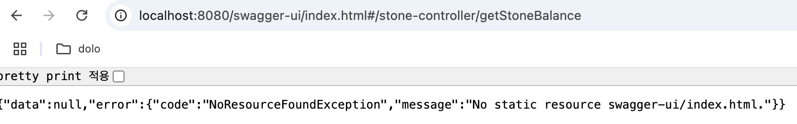

(접속은 되는데 페이지가 뜨지 않는 것을 확인할 수 있다)

5. 특정 API 만 노출


```javascript
@Bean
    fun showApi(): GroupedOpenApi {
        return GroupedOpenApi
            .builder()
            .group("AdminController")
            .pathsToMatch(
                "/api/admin/v1/users/fcm",
                "/api/admin/v1/users/fcm/{{os}}",
                "/api/v1/chat/rooms/{{chatRoomId}}/trigger-main-event"
            )
            .build()
    }
```


return OpenApi 는 전체적인 설정을 담당하고, return GroupedOpenApi 는 그룹에 대한 설정을 담당한다.

추가로 GroupedOpenApi 를 작성해두고 pathsToMatch 에 경로를 적어두면 경로에 해당하는 API 만 노출되는 것을 확인할 수 있다.

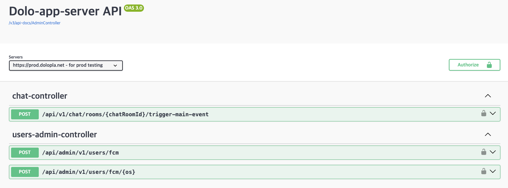

6. 특정 API 예외 처리

```javascript
@Configuration
class SecurityConfig(private val jwtTokenProvider: JwtTokenProvider) {
    @Bean
    fun securityFilterChain(http: HttpSecurity): SecurityFilterChain {
        http
            .csrf { csrf -> csrf.disable() }
            .authorizeHttpRequests { requests ->
                requests
                    .requestMatchers("/health").permitAll()
                    .requestMatchers("/swagger-ui/**").permitAll()
                    .requestMatchers("/v3/api-docs/**").permitAll()
                    .requestMatchers("$APP_PREFIX/stones/charge").permitAll()
                    .requestMatchers("$APP_PREFIX/users/signup").permitAll()
                    .requestMatchers("$PUBLIC_PREFIX/**").permitAll()
                    .requestMatchers("$INTERNAL_PREFIX/**").permitAll() // TODO: Dify 에서만 허용하도록 변경.
                    .requestMatchers("$ADMIN_PREFIX/**").hasRole(User.Role.ADMIN.name)
                    .anyRequest().authenticated()
            }
```

- securityConfig 에 .permitAll() 로 설정해두면 인증 없이 API 사용 가능합니다


```javascript
POST {{host}}/api/v1/stones/charge?
    userId=Uk9XW1QgLikjUFNXLVxzUFN7WVdOQm4=&
    stoneAmount=100
```


Authorization Bearer \{\{token\}\} 없이 api 사용 가능함

Q. swagger 에서도 특정 API 만 인증 안 받게 하고 싶어요!

```javascript
@SecurityRequirements(value = [])
@PostMapping()
...
```

이렇게 설정하면 됩니다! (<code>SecurityRequirements</code> 임! <b><code>SecurityRequirement</code></b><b> 랑 헷갈리지 않게 주의!!</b>)

자자 여기까지 설정을 마쳤다면!

이제 이 주소에서 swagger 를 사용할 수 있습니다.

http://localhost:8080/swagger-ui/index.html<br />(실제 aws 서버에서 돌아갈 때는 aws 서버 주소/swagger-ui/index.html 이렇게 들어가면 됨)

접속 화면

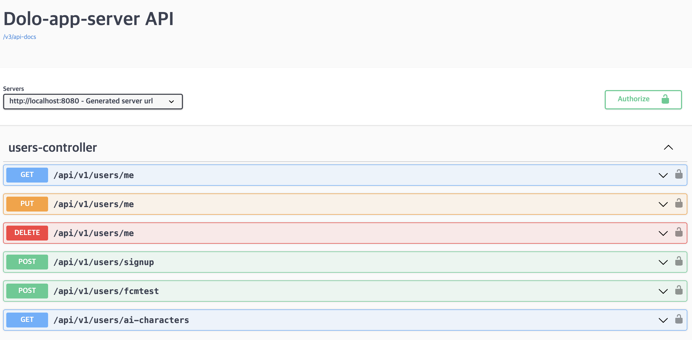

아까 @Configuration 에서 .addSecuritySchemes 를 추가해두었기 때문에 오른쪽 끝에 자물쇠 표시가 뜨는 것을 확인할 수 있다. (추가 안 하면 안 뜸)

자물쇠 클릭하면 이렇게 뜬다. 여기서 token 입력하면 된다.

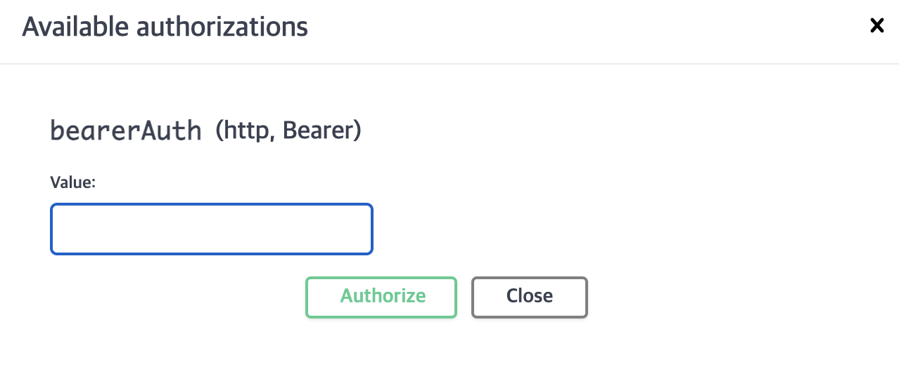

테스트

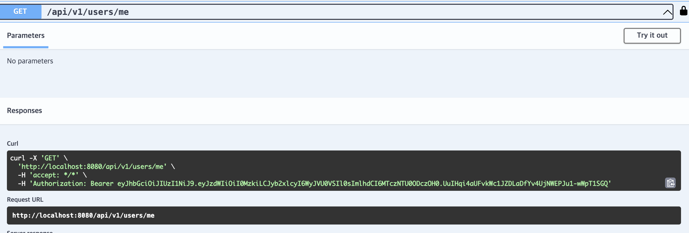

펼쳐보면 입력으로 넣을 parameter 의 이름과 타입, 그리고 결과로 받을 json 의 형태를 확인할 수 있다.

try it out 을 눌러서 API 에 직접 데이터를 넣어서 결과를 받아볼 수 있다.

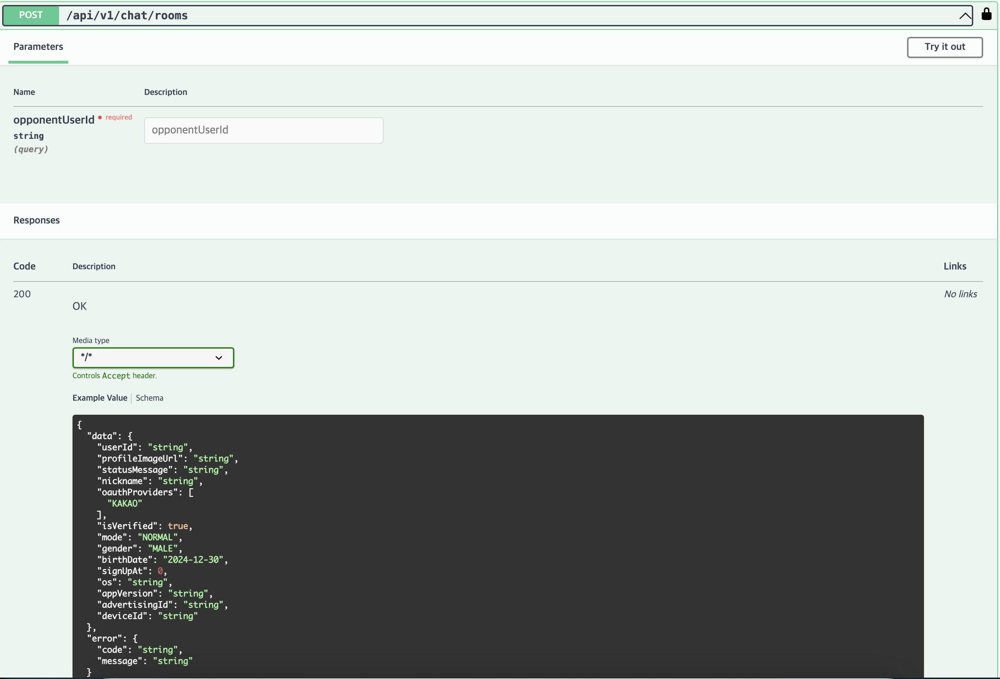

### \*\*근데 선생님! 서버 올리고 실행했는데 이렇게 에러 뜨는데요?

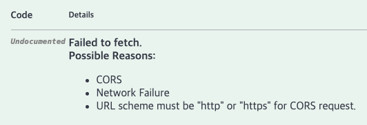

흠.. CORS 가 뭘까요? → [CORS 설명](/16e3abb1a94d80fb9444d5abc632bd46?pvs=25)

위 에러가 발생한 이유는 이렇습니다

Q. swagger 를 dev 서버에서 실행했을 때 왜 CORS 에러가 떴나요?

- swagger server 자체는 https 로 동작하는데, 요청이 http 로 들어와서 그래요!
- 결과적으로 같은 출처가 아니라 ‘다른 출처’ 로 인식됐기 때문입니다!
- 서버에 CORS 설정이 안되어 있어서 CORS 에러가 뜬 겁니당

<br />자 \~ 그럼 다시 문제로 돌아와서 확인을 해볼게요\~

서버에서 동작하는 swagger 주소는 다음과 같습니다.

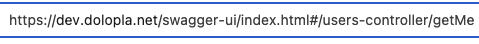

요청을 볼까요?

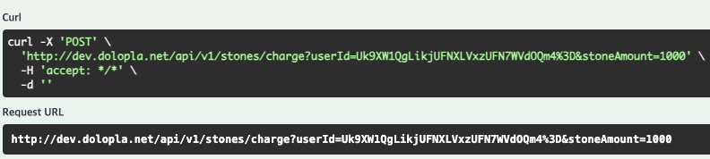

이러언\~ http 로 요청하고 있네요!

그럼 우리는 swaggerConfig 에서 서버의 주소를 명시해 주면 됩니다!

이렇게 할 수 있어요

```javascript
.servers(
	        listOf(
	            Server().url("https://dev.dolopla.net").description("dolo dev server")
	        )
	    )
```

.servers 명령을 이용해 swagger 요청이 보내질 서버의 주소를 명시해주는 겁니다!

이렇게 지정해주면! swagger 요청이 우리가 지정한 주소로 보내지는 것을 확인할 수 있습니다!

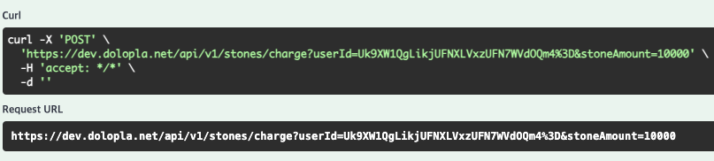

(로컬에서 실행한 모습이에요! 로컬에서 실행했는데도 https 로 dolopla 에 요청하는 거 보이시나용??👀)

Q. 근데 왜 list 에요? 한 서버로 보내는 게 아니라 여러 서버로 보낼 수 있나요?

- 네! 정확히 말하면 ‘여러 서버’ 를 지정해둘 수 있습니다! 이 경우에는 api 를 보낼 때 어디로 보낼지 선택할 수 있어요!
- 여러 서버를 지정해두면 이렇게 선택할 수 있습니다!
  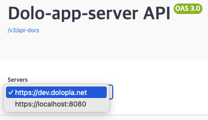

Q. 그럼 왜 로컬에서 실행했을 때는 cors 안 떴어요?

- 로컬 서버를 http 로 열었기 때문이에요!<br />(왜요? → 여러 이유가 있는데, 그게 테스트하기 편해서 그래용)
- https 로 요청하게 된다면 서버에 http 로 요청했을 때와 마찬가지로 CORS 요청이 보이는 것을 확인할 수 있습니다!

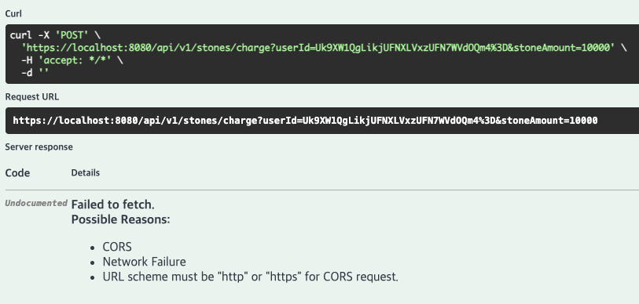
