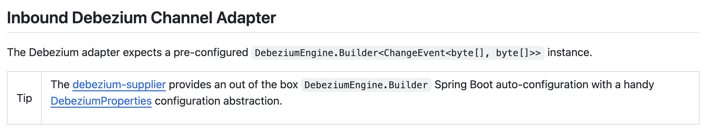
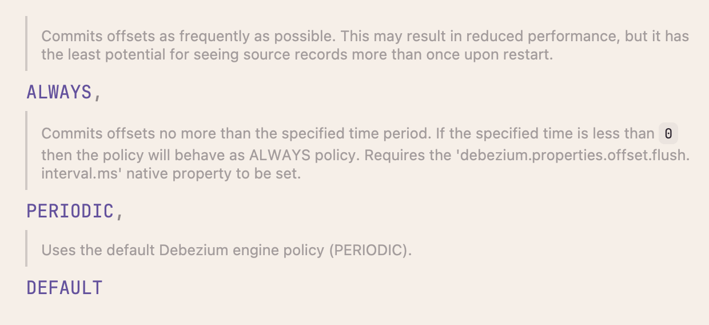

원문: [Notion에서 보기](https://app.notion.com/p/2c23abb1a94d816caaaae3dd153cd000?pvs=204)

# Spring 에 Debezium 의존성 추가하기

### 공식문서

[Debezium Support :: Spring Integration](https://docs.spring.io/spring-integration/reference/debezium.html?utm_source=chatgpt.com#debezium-java-dsl)

## 문제

- 공식문서에는 의존성을 추가하면 DebeziumEngine.Builder 가 자동으로 생성된다고 나와잇지만, 자동으로 생성되지 않는다.

## 해결

- [GitHub debezium integration 의 support 문서](https://github.com/spring-projects/spring-integration/blob/173c408dd99692fc6c063fdb6b9d82d35e3b1053/src/reference/antora/modules/ROOT/pages/debezium.adoc#inbound-debezium-channel-adapter)를 보면 debezium-supplier 라는 친구가 자동 구성을 해준다는 걸 알 수잇음
  
- 그래서 아래 의존성을 추가
  ```javascript
  implementation(platform("org.springframework.cloud.fn:spring-functions-catalog-bom:5.1.1"))
      implementation("org.springframework.cloud.fn:spring-debezium-supplier:5.0.2") {
          exclude group: "io.debezium", module: "debezium-connector-mongodb"
      }
  ```
- 참고로 사용하는 의존성은 아래와 같다. 공식문서에서 권하는 <br /><code>implementation 'org.springframework.integration:spring-integration-debezium:6.5.3'</code> <br />을 사용하지 않고 Debezium Supplier 기반으로 처리한다.

```javascript
// Debezium Supplier 기반 CDC 처리
implementation(platform("org.springframework.cloud.fn:spring-functions-catalog-bom:5.1.1"))
implementation("org.springframework.cloud.fn:spring-debezium-supplier:5.1.1") {
    exclude group: "io.debezium", module: "debezium-connector-mongodb" // 필요 없는 커넥터 제외
}
implementation "io.debezium:debezium-embedded:3.3.1.Final"
implementation "io.debezium:debezium-connector-postgres:3.3.1.Final"
implementation "org.postgresql:postgresql:42.7.8"
```


### 참고) Integration Adapter 방식 vs Supplier 방식

```javascript
✅ Integration Adapter 방식 (spring-integration-debezium)

특징
	•	Debezium Engine을 직접 구성하거나 DebeziumEngine.Builder<ChangeEvent<…>> 를 제공하고, 이를 통해 변경 이벤트(Insert/Update/Delete)를 캡처합니다.  
	•	캡처된 이벤트를 Spring Integration 메시지 채널(MessageChannel)로 전달하고, 그 후 개발자가 이를 구성한 흐름(Integration Flow)에서 처리합니다.  
	•	개발자가 메시지 흐름, 필터링, 변환, 배치처리 등 Integration 패턴을 직접 구성하면서 복잡한 흐름을 구현할 수 있습니다.

장점
	•	매우 유연한 이벤트 흐름 구성 가능: 커스텀 채널 설정, 배치 처리, 헤더 매핑, Spring Integration DSL 활용 등이 가능.
	•	Debezium 엔진을 직접 제어하기 위한 낮은 레벨 접근이 가능하므로, 복잡하거나 맞춤형 CDC 요건이 있는 경우 유리합니다.

단점
	•	설정이 비교적 복잡하고 코드/설정량이 많아질 수 있습니다.
	•	Spring Integration 개념(채널, 흐름 등)을 잘 이해해야 하고 유지보수가 더 부담스러울 수 있습니다.
	•	Supplier 방식에 비해 도입/구동이 더 무겁게 느껴질 수 있습니다.

⸻

✅ Supplier 방식 (spring-debezium-supplier)

특징
	•	Spring Cloud Fn/Cloud Stream 스타일로 Supplier<Flux<Message<…>>> 또는 Function 형태의 바인더 기반 구성을 이용합니다.
	•	내부에서 Debezium Engine을 자동 구성하고, 필요한 Debezium 커넥터, 속성 등을 쉽게 설정할 수 있도록 되어 있습니다.  
	•	개발자는 비즈니스 로직(예: 메시지 발행, 변환, 브로커 전송)에 집중할 수 있고, CDC 엔진과 메시징 바인더를 “내부적으로 동작하게끔” 맡기는 형태입니다.

장점
	•	설정 및 구현이 비교적 간단하고 빠르게 시작 가능.
	•	Spring Cloud Stream/바인더 기반으로 메시지 브로커(RabbitMQ, Kafka 등) 연동이 자연스럽습니다.
	•	비즈니스 로직 중심으로 개발할 수 있어 생산성이 높아질 수 있습니다.

단점
	•	Integration Adapter 방식만큼 세세하게 흐름을 커스터마이즈 하기는 어렵습니다.
	•	내부 구성(엔진, 바인더 등)을 자동화해 주는 만큼 “흐름을 완전히 컨트롤해야 하는 경우” 제약을 느낄 수 있습니다.
	•	특정 고급 기능(예: 복잡한 배치, 채널 조작)에서 제약이 있을 수 있습니다.
```


### Debezium-Supplier 설정

- debezium-supplier git 레포지토리 주소는 아래와 같음
  - [spring-functions-catalog/supplier/spring-debezium-supplier at 7b1d3ab92fe4c3f88a2c4329cec3408974d77a11 · spring-cloud/spring-functions-catalog](https://github.com/spring-cloud/spring-functions-catalog/tree/7b1d3ab92fe4c3f88a2c4329cec3408974d77a11/supplier/spring-debezium-supplier)
- ReadMe
  - [spring-functions-catalog/common/spring-debezium-autoconfigure/README.adoc at 7b1d3ab92fe4c3f88a2c4329cec3408974d77a11 · spring-cloud/spring-functions-catalog](https://github.com/spring-cloud/spring-functions-catalog/blob/7b1d3ab92fe4c3f88a2c4329cec3408974d77a11/common/spring-debezium-autoconfigure/README.adoc)
- <b><span color="blue">DebeziumEngineBuilderAutoConfiguration.java</span></b> 파일을 보면 아래와 같은 코드가 있음
  ```javascript
  @AutoConfiguration
  @EnableConfigurationProperties(DebeziumProperties.class)
  @Conditional(DebeziumEngineBuilderAutoConfiguration.OnDebeziumConnectorCondition.class)
  @ConditionalOnProperty(prefix = "debezium", name = "properties.connector.class")
  public class DebeziumEngineBuilderAutoConfiguration {
  ```

  - 여시서 중요한 건 yml 에 <b><span color="blue">debezium.properties.connector.class</span></b> 가 있어야 한다는 것.
  - 그리고 그 종류는 <b><span color="blue">DebeziumEngineBuilderAutoConfiguration.OnDebeziumConnectorCondition.class</span></b><span color="blue"> </span>에 명시된 것 중에 하나여야 한다는 것이다.
    - 해당 클래스의 코드를 보면 postgresql 에 관한 게 잇음

    ```javascript
    @Order
    	static class OnDebeziumConnectorCondition extends AnyNestedCondition {

    		OnDebeziumConnectorCondition() {
    			super(ConfigurationPhase.REGISTER_BEAN);
    		}

    		@ConditionalOnClass(name = { "io.debezium.connector.mysql.MySqlConnector" })
    		static class HasMySqlConnector {

    		}

    		@ConditionalOnClass(name = "io.debezium.connector.postgresql.PostgresConnector")
    		static class HasPostgreSqlConnector {

    		}
    ```

    - <b><span color="blue">io.debezium.connector.postgresql.PostgresConnector</span></b> 을 추가해서 yml 을 구성
    - 최종적으로 이런저런 설정 붙여서 yml 구성하면 debeziumEngine.Builder 가 자동 생성되어 서버를 띄울 수 있다. 사용하는 yml 구성은 아래와 같다.

    ```javascript
    debezium:
      # Spring Integration Debezium wrapper 용 옵션
      payloadFormat: JSON # 수신된 이벤트의 키/값을 Json 으로 직렬화하도록 설정. 성능 개선 필요 시 PROTOBUF 로 변경 고려
      offsetCommitPolicy: DEFAULT # 오프셋 커밋 정책 설정. DEFAULT(= PERIODIC), ALWAYS: 각 이벤트마다(성능 저하), PERIODIC: 일정 주기마다

      properties:
        name: order-worker-connector
        # (필수) CDC 소스 데이터베이스 타입
        connector.class: io.debezium.connector.postgresql.PostgresConnector

        # Postgres 접속 정보
        database.hostname: order-postgres
        database.port: 5432
        database.user: ${SPRING_DATASOURCE_USERNAME:orderuser}
        database.password: ${SPRING_DATASOURCE_PASSWORD:orderpass}
        database.dbname: orderdb

        # 변경 로그 디코딩 플러그인
        plugin.name: pgoutput # pgoutput 이 표준

        # 이벤트 토픽 이름 접두사. Debezium 은 변경 이벤트를 토픽 형태로 발행함.
        topic.prefix: orderdb

        # replication slot / publication 설정
        slot.name: replication_slot
        publication.name: publication1
        publication.autocreate.mode: filtered # publication 에 포함될 테이블을 필터에 따라 결정
        table.include.list: public.order_outbox # filtered 모드에서 필요한 테이블 필터

        # offset
        offset.storage: org.apache.kafka.connect.storage.FileOffsetBackingStore # 오프셋을 파일에 저장
        offset.storage.file.filename: /etc/debezium/offsets.dat
        offset.flush.interval.ms: 6000  # 오프셋을 저장 주기를 10초로 설정

        # schema
        schema.history.internal: io.debezium.relational.history.FileSchemaHistory # 스키마를 파일에 저장
        schema.history.internal.file.filename: /etc/debezium/schema_history.dat

        # snapshot
        snapshot.mode: initial # initial : 이전에 저장된 오프셋이 없을 때 전체 스냅샷을 수행하고, 이후에는 로그 스트리밍으로 전환

        # DECIMAL(BIGDECIMAL) / NUMERIC 필드 처리 모드 설정
        # 기본적으로 DECIMAL(BIGDECIMAL) 은 Byte 타입 + Base64 인코딩된 값으로 전달됨. 그래서 파싱이 복잡해짐
        # string 모드로 설정하여 값이 문자열로 전달되게 할 수 있음.
        decimal:
          handling:
            mode: string

    ```


### 참고)

- 얘가 mongodb 관련 의존성도 같이 끌고 와서 서버 띄울 때마다 mongo 커넥션을 생성하려 한다. 로그 뜨는 거 귀찮으면 exclude 해두는 거 추천

```javascript
implementation("org.springframework.cloud.fn:spring-debezium-supplier:5.0.2") {    exclude group: "io.debezium", module: "debezium-connector-mongodb"}
```

- 레플리카 슬롯을 생성하기 위해서는 postgresql 의 wal\_level 이 logical 이상이어야 한다.
  ```javascript
  Caused by: org.postgresql.util.PSQLException: ERROR: logical decoding requires wal_level >= logical
  ```

  - 그래서 docker-compose 에 다음 코드를 추가한다.

  ```javascript
    order-postgres:
      image: postgres:16
      container_name: order-postgres
      restart: always
      environment:
        - POSTGRES_DB=orderdb
        - POSTGRES_USER=orderuser
        - POSTGRES_PASSWORD=orderpass
      command:
        - postgres
        - -c
        - wal_level=logical
        - -c
        - max_wal_senders=10
        - -c
        - max_replication_slots=10
      ports:
        - "5433:5432"
      volumes:
        - order_pgdata:/var/lib/postgresql/data
  ```

  - 참고로 이 설정을 추가한다고 하더라도, 이미 볼륨이 띄워진 상태에서는 적용이 되지 않는다.
  - 그러니까 docker-compose down -v 로 다 내리고 다시 docker-compose up --build -d 로 띄워야 한다.

### applicatoin.yml

<code>offsetCommitPolicy: ALWAYS</code>



```javascript
ALWAYS
	•	가능한 한 매 이벤트마다 오프셋을 커밋합니다.
	•	성능은 다소 떨어질 수 있지만, 재시작 시 중복 이벤트를 볼 가능성이 가장 적습니다.
	•	즉 “읽은 이벤트는 바로 커밋”하는 정책입니다.
	•	따라서 장애나 재시작 시 중복 처리가 거의 없습니다.
	•	주의: 이건 Debezium 엔진 입장에서의 커밋이지, “이벤트 핸들러가 성공적으로 처리되었을 때만 커밋”을 보장하진 않습니다.
즉, 핸들러에서 throw 되어도 Debezium 엔진은 이미 오프셋을 커밋했을 가능성이 있습니다.

PERIODIC
	•	일정 주기(debezium.properties.offset.flush.interval.ms)마다 오프셋을 커밋합니다.
	•	Debezium의 기본 정책(default) 이기도 합니다.
	•	주기를 너무 길게 잡으면 장애 복구 시 이미 처리된 이벤트가 중복될 수 있고, 너무 짧으면 성능에 영향이 있습니다.

DEFAULT
	•	Debezium 엔진의 기본값(PERIODIC)과 동일합니다.
	•	별도로 지정하지 않으면 이 정책이 사용됩니다.
```


## Debezium 은 왜 Replication slot 을 생성하고 거기서 로그를 읽는가?

- 메인 db 는 로그가 사라질 수도 있고,

## 스냅샷은 왜 필요한가?

- 어디까지 읽엇는지 기억하려고. 근데 오프셋 잇으면 어느정도 커버된다고 함
