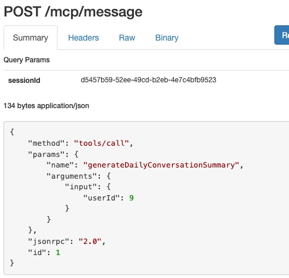
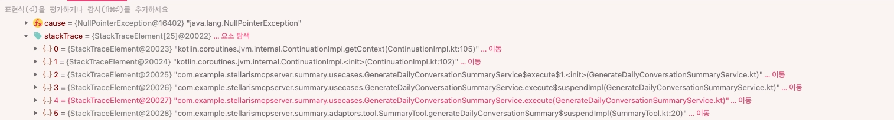
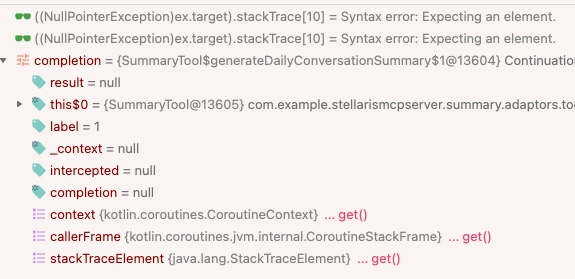

원문: [Notion에서 보기](https://app.notion.com/p/3873abb1a94d807d831ce37cace1b0aa?pvs=204)

# Spring MCP @Tool에서 suspend fun이 실패한 이유

<b>\* 정리 전 작성해두었던 원문입니다!</b>

[@Tool 어노테이션 사용 시 suspend fun 내부에서 suspend fun 호출 안됨](https://app.notion.com/p/2843abb1a94d80c98926d68a62c093eb) 

[상태 머신과 컨텍스트 전달](https://app.notion.com/p/2853abb1a94d80eda4f2e26d56227474) 

[코루틴 컨텍스트와 CoroutineScope { } vs coroutineScope {}](https://app.notion.com/p/2533abb1a94d80adadd5d941e0316c78) 

[컨텍스트와 await, CoroutineScope, coruotineScope](https://app.notion.com/p/2843abb1a94d80d28d5cef6f50d476b0) 

[suspend fun 은 항상 상태머신을 갖게 될까?](https://app.notion.com/p/2853abb1a94d80eb8a5ff6610e409a65) 

Spring WebFlux 기반 애플리케이션에서는 Kotlin의 <code>suspend fun</code>을 사용해 비동기 코드를 동기 코드처럼 작성할 수 있다.

예를 들어 다음과 같은 코드는 순차 실행처럼 보이지만, 실제로는 thread를 blocking하지 않고 suspend/resume 방식으로 동작한다.

```kotlin
suspend fun execute(input: Input): Output {
    val user = userRepository.findById(input.userId)
    val summary = llmClient.generate(user)
    return Output(summary)
}
```

WebFlux와 Kotlin Coroutine을 함께 사용할 때 기대하는 일반적인 작성 방식이다.

그런데 Spring MCP Tool을 구현하면서 <code>@Tool</code>이 붙은 메서드를 <code>suspend fun</code>으로 작성하자 예상과 다른 문제가 발생했다.

이 글은 <code>@Tool</code>을 method-based Tool로 등록하고, Spring AI의 <code>MethodToolCallback</code> 계열 실행 경로를 통해 MCP Tool로 호출한 상황을 기준으로 정리한다.

## 1. 문제 상황

처음 작성한 Tool 코드는 다음과 같았다.

```kotlin
@Component
class SummaryTool(
    private val generateDailyConversationSummaryService: GenerateDailyConversationSummaryService
) {

    @Tool
    suspend fun generateDailyConversationSummary(
        input: GenerateDailyConversationSummaryService.Input
    ): GenerateDailyConversationSummaryService.Output {
        val result = generateDailyConversationSummaryService.execute(input)
        return result
    }
}
```

<code>@Tool</code> 메서드 자체도 <code>suspend fun</code>이고, 내부에서 호출하는 Service 메서드도 <code>suspend fun</code>이다.

Service는 대략 다음 구조였다.

```kotlin
@Service
class GenerateDailyConversationSummaryService(
    private val userRepository: UserRepository,
    private val llmClient: LlmClient
) {

    suspend fun execute(input: Input): Output {
        println("Generating daily conversation...")

        val user = userRepository.findById(input.userId)
        val summary = llmClient.generate(user)

        return Output(summary)
    }
}
```

처음에는 Tool input binding 문제라고 생각했다.

MCP client에서 <code>tools/call</code> 요청이 정상적으로 들어오는지, JSON 구조가 맞는지, <code>input.userId</code>가 정상적으로 전달되는지부터 확인했다.

하지만 요청은 정상적으로 들어오고 있었다.



즉, 문제는 MCP 요청 수신이나 input binding이 아니었다.

디버깅 결과, 실패 지점은 Service 로직에 정상 진입하기 전이었다. Stack trace에서는 Kotlin Coroutine 내부의 <code>ContinuationImpl.getContext()</code> 부근에서 <code>NullPointerException</code>이 발생하고 있었다.



디버거로 continuation 내부 상태를 보면 <code>completion = null</code>, <code>_context = null</code> 상태가 확인됐다.



이 시점에서 문제는 단순히 “Service 호출이 안 된다”가 아니라, “<code>@Tool</code> 실행 경로에서 Kotlin suspend 함수의 호출 규약이 깨지고 있다”에 가깝다고 판단했다.

## 2. 원인 요약

결론부터 정리하면 문제의 핵심은 <code>suspend fun</code> 자체가 아니다.

핵심은 다음 두 가지가 만나는 지점이다.

1. Spring AI의 method-based <code>@Tool</code> 실행기는 Java reflection 기반으로 Tool method를 호출한다.
2. Kotlin의 <code>suspend fun</code>은 JVM에서 일반 메서드가 아니라, 마지막 인자로 <code>Continuation</code>을 받는 메서드로 변환된다.

즉, Spring AI 입장에서는 <code>@Tool</code>이 붙은 method를 reflection으로 호출하면 된다.

하지만 Kotlin 입장에서 그 method가 <code>suspend fun</code>이라면 일반 method 호출과 다르다. 정상적인 coroutine continuation이 함께 연결되어야 한다.

이 호출 규약이 맞지 않으면, suspend 함수 내부에서 상태 머신이 실행되는 과정에서 continuation context 접근이 실패할 수 있다.

## 3. <code>@Tool</code>은 어떻게 실행되는가

Spring AI의 method-based Tool 실행 경로는 내부적으로 <code>Method.invoke()</code>를 사용한다.

핵심 코드는 다음 구조다.

```java
@Nullable
private Object callMethod(Object[] methodArguments) {
    if (isObjectNotPublic() || isMethodNotPublic()) {
        this.toolMethod.setAccessible(true);
    }

    Object result;

    try {
        result = this.toolMethod.invoke(this.toolObject, methodArguments);
    }
    catch (IllegalAccessException ex) {
        throw new IllegalStateException("Could not access method: " + ex.getMessage(), ex);
    }
    catch (InvocationTargetException ex) {
        throw new ToolExecutionException(this.toolDefinition, ex.getCause());
    }

    return result;
}
```

Java method를 Tool로 실행하는 관점에서는 자연스러운 구현이다.

Tool input JSON을 method argument로 변환하고, <code>Method.invoke()</code>로 대상 method를 호출하면 된다.

하지만 Kotlin <code>suspend fun</code>은 JVM에서 일반 Java method처럼 호출되는 함수가 아니다.

## 4. Kotlin <code>suspend fun</code>은 JVM에서 어떻게 바뀌는가

다음과 같은 Kotlin suspend 함수가 있다고 하자.

```kotlin
suspend fun execute(input: Input): Output
```

이 함수는 JVM에서 개념적으로 다음과 같은 형태로 변환된다.

```java
Object execute(Input input, Continuation<? super Output> completion)
```

원래 Kotlin 코드에는 <code>Continuation</code> 파라미터가 없다. 하지만 컴파일된 JVM method signature에는 마지막 인자로 <code>Continuation</code>이 추가된다.

반환 타입도 <code>Output</code> 그대로가 아니다. suspend 함수는 즉시 결과를 반환할 수도 있고, 중단될 수도 있기 때문에 JVM 수준에서는 <code>Any?</code>, Java 관점에서는 <code>Object</code>에 가까운 타입으로 변환된다.

실행 결과는 두 가지 중 하나다.

1. 함수가 중단되지 않고 끝나면 실제 결과 값을 반환한다.
2. 함수가 중단되면 <code>COROUTINE_SUSPENDED</code> marker를 반환한다.

이때 <code>Continuation</code>은 단순 callback이 아니다.

현재 coroutine이 어떤 context에서 실행되는지, suspend 이후 어디로 resume되어야 하는지, 결과나 예외를 어떻게 전파할지를 담는 실행 제어 객체다.

일반적인 suspend 함수 호출에서는 Kotlin compiler와 coroutine runtime이 이 <code>Continuation</code>을 자동으로 연결한다.

예를 들어 suspend 함수 안에서 다른 suspend 함수를 호출하면,

```kotlin
val result = service.execute(input)
```

컴파일 후에는 개념적으로 다음처럼 현재 continuation이 하위 suspend 함수로 전달된다.

```java
Object result = service.execute(input, currentContinuation);
```

그래야 하위 suspend 함수가 같은 coroutine 흐름 안에서 실행되고, suspend 이후에도 올바른 지점으로 resume될 수 있다.

문제는 Java reflection의 <code>Method.invoke()</code>가 Kotlin suspend 함수의 호출 규약을 이해하지 못한다는 점이다.

<code>Method.invoke()</code>는 “이 method가 Kotlin suspend 함수니까 현재 coroutine continuation을 생성하거나 연결해야겠다”는 처리를 하지 않는다.

따라서 <code>@Tool suspend fun</code>이 reflection 기반 실행 경로를 타면, 정상적인 continuation이 연결되지 않은 상태로 suspend 함수가 호출될 수 있다.

## 5. 상태 머신이 있는 suspend 함수는 왜 실패하는가

Kotlin Coroutine은 suspend 함수를 상태 머신으로 변환한다.

suspend 함수는 실행 도중 멈췄다가 나중에 이어서 실행될 수 있어야 한다. 그러려면 다음 정보가 저장되어야 한다.

- 현재 어느 지점까지 실행했는지
- 중단 전 지역 변수 값이 무엇이었는지
- 다음 resume 시 어느 분기부터 실행해야 하는지
- 결과나 예외를 어느 continuation으로 전달해야 하는지

이를 위해 compiler는 suspension point가 있는 suspend 함수를 state machine 형태로 바꾼다.

예를 들어 다음 코드가 있다고 하자.

```kotlin
suspend fun execute(input: Input): Output {
    println("start")

    val user = userRepository.findById(input.userId)
    val summary = llmClient.generate(user)

    return Output(summary)
}
```

<code>findById</code>, <code>generate</code>가 suspend 함수라면 이 함수 내부에는 suspension point가 있다.

따라서 이 함수는 단순한 순차 method가 아니라, 중단과 재개가 가능한 상태 머신으로 변환된다.

개념적으로는 다음 흐름에 가깝다.

```kotlin
when (label) {
    0 -> {
        println("start")

        label = 1
        val userResult = userRepository.findById(input.userId, continuation)

        if (userResult == COROUTINE_SUSPENDED) {
            return COROUTINE_SUSPENDED
        }
    }

    1 -> {
        val user = resultFromPreviousStep

        label = 2
        val summaryResult = llmClient.generate(user, continuation)

        if (summaryResult == COROUTINE_SUSPENDED) {
            return COROUTINE_SUSPENDED
        }
    }

    2 -> {
        val summary = resultFromPreviousStep
        return Output(summary)
    }
}
```

실제 bytecode는 더 복잡하지만 핵심은 같다.

상태 머신은 현재 continuation을 전제로 동작한다. continuation이 정상적으로 연결되어 있어야 context를 가져오고, suspend 이후 resume 위치를 관리하고, 예외도 상위 coroutine 흐름으로 전파할 수 있다.

그런데 <code>@Tool</code> 실행 경로에서 정상적인 continuation이 연결되지 않으면 상태 머신이 동작하는 과정에서 문제가 발생한다.

이번 케이스에서는 <code>ContinuationImpl.getContext()</code>에서 <code>_context</code>가 null인 상태로 접근되면서 NPE가 발생했다.

즉, 실패의 직접 원인은 Service 로직 자체가 아니라, Service의 suspend 함수가 실행되기 위해 필요한 continuation context가 정상적으로 연결되지 않은 것이다.

## 6. 그런데 왜 어떤 <code>suspend fun</code>은 실행된 것처럼 보였을까

처음에 가장 헷갈렸던 부분은 이 지점이었다.

어떤 <code>@Tool suspend fun</code>은 실패했지만, 어떤 코드는 정상적으로 동작하는 것처럼 보였다.

예를 들어 다음 코드가 있었다.

```kotlin
@Component
class ChatTool(
    private val saveChatService: SaveChatService
) {

    @Tool
    suspend fun saveChat(
        input: SaveChatService.Input
    ): ResponseEntity<String> {
        saveChatService.execute(input)
        return ResponseEntity.ok("ok")
    }
}
```

Service는 다음 구조였다.

```kotlin
@Service
class SaveChatService(
    private val dbSaveCoroutineScope: DbSaveCoroutineScope,
    private val chatRepository: ChatRepository
) {

    suspend fun execute(input: Input) {
        val chat = Chat(
            id = UUID.randomUUID().toString(),
            userId = input.userId,
            text = input.text
        )

        dbSaveCoroutineScope.async {
            chatRepository.save(chat)
        }
    }
}
```

겉으로 보면 이 코드도 <code>@Tool suspend fun</code> 내부에서 Service의 <code>suspend fun execute()</code>를 호출한다.

그런데 이 코드는 실행되는 것처럼 보였다.

차이는 <code>execute()</code> 함수 본문에 실제 suspension point가 없었다는 점이다.

```kotlin
suspend fun execute(input: Input) {
    val chat = Chat(...)

    dbSaveCoroutineScope.async {
        chatRepository.save(chat)
    }
}
```

이 함수는 <code>suspend fun</code>으로 선언되어 있지만, 함수 본문에서 직접 suspend되지 않는다.

<code>async</code>를 호출하지만, 그 결과를 <code>await()</code>하지 않는다. 즉, 현재 <code>execute()</code> 함수는 외부 scope에 작업을 등록하고 바로 반환한다.

따라서 <code>execute()</code> 자체만 보면 suspend될 지점이 없다.

이 경우 Kotlin compiler는 full state machine 변환 경로를 타지 않을 수 있다. 그래서 깨진 continuation 문제가 즉시 드러나지 않고, 코드가 실행된 것처럼 보일 수 있다.

하지만 이것은 <code>@Tool suspend fun</code>이 정상적으로 지원된 사례가 아니다.

정확히는 다음에 가깝다.

- 함수는 <code>suspend fun</code>으로 선언되어 있다.
- 하지만 함수 본문에는 실제 suspension point가 없다.
- 외부 scope에 비동기 작업을 던지고 바로 반환한다.
- 따라서 현재 함수의 상태를 보존하고 resume할 필요가 없다.
- 그래서 continuation 문제가 겉으로 드러나지 않은 것이다.

즉, “실행됐다”와 “정상적인 coroutine 호출 규약으로 안전하게 실행됐다”는 다르다.

## 7. <code>suspend fun</code>이라고 항상 full state machine을 갖는 것은 아니다

여기서 중요한 질문이 생긴다.

> <code>suspend fun</code>은 항상 상태 머신을 가질까?

항상 full state machine 변환이 적용되는 것은 아니다.

Kotlin compiler는 suspend 함수 내부의 suspension point를 분석한다. 내부에 suspension point가 없거나, 모든 suspension point가 tail-call 최적화 조건을 만족하면 full state machine 생성을 피하는 경로를 탈 수 있다.

Kotlin compiler의 coroutine 변환부를 보면 먼저 suspension point를 수집한다.

```kotlin
// CoroutineTransformerMethodVisitor.kt

val suspensionPoints = collectSuspensionPoints(methodNode)

...

if (isForNamedFunction) {
    if (methodNode.allSuspensionPointsAreTailCalls(
            suspensionPoints,
            !disableTailCallOptimizationForFunctionReturningUnit
        )
    ) {
        methodNode.addCoroutineSuspendedChecks(suspensionPoints)
        dropSuspensionMarkers(methodNode)
        dropUnboxInlineClassMarkers(methodNode, suspensionPoints)
        return
    }

    ...
}
```

핵심은 <code>collectSuspensionPoints(methodNode)</code>로 suspension point를 먼저 수집한다는 점이다.

그리고 named suspend function에 대해 <code>allSuspensionPointsAreTailCalls(...)</code> 조건을 확인한다.

관련 함수는 대략 다음 흐름이다.

```kotlin
// TailCallOptimization.kt

internal fun MethodNode.allSuspensionPointsAreTailCalls(
    suspensionPoints: List<SuspensionPoint>,
    optimizeReturnUnit: Boolean
): Boolean {
    ...

    return suspensionPoints.all { suspensionPoint ->
        val index = instructions.indexOf(suspensionPoint.suspensionCallBegin)

        tryCatchBlocks.all {
            index < instructions.indexOf(it.start) ||
                instructions.indexOf(it.end) <= index
        } &&
            suspensionPoint.suspensionCallEnd
                .transitiveSuccessorsAreSafeOrReturns()
    }
}
```

여기서 중요한 부분은 다음 코드다.

```kotlin
return suspensionPoints.all { suspensionPoint ->
    ...
}
```

Kotlin에서 <code>emptyList<T>().all { ... }</code>은 true를 반환한다.

따라서 함수 내부에 suspension point가 없다면 <code>suspensionPoints</code>는 empty list가 되고, 이 조건은 true가 된다. 그 결과 compiler는 full state machine 생성 경로로 내려가지 않고 return할 수 있다.

이 관점에서 보면 앞선 <code>SaveChatService.execute()</code>가 실행된 것처럼 보인 이유를 설명할 수 있다.

```kotlin
suspend fun execute(input: Input) {
    val chat = Chat(...)

    dbSaveCoroutineScope.async {
        chatRepository.save(chat)
    }
}
```

이 함수는 <code>suspend fun</code>이지만 본문에서 직접 suspend되지 않는다. 따라서 현재 함수 자체에는 resume해야 할 지점이 없다.

반면 아래 함수는 다르다.

```kotlin
suspend fun execute(input: Input): Output {
    println("Generating daily conversation...")

    val user = userRepository.findById(input.userId)
    val summary = llmClient.generate(user)

    return Output(summary)
}
```

<code>findById</code>, <code>generate</code>가 suspend 함수라면 이 함수에는 실제 suspension point가 있다.

따라서 상태 머신이 필요하고, 상태 머신은 정상적인 continuation context를 전제로 동작한다.

이 차이 때문에 같은 <code>suspend fun</code>처럼 보이더라도 하나는 실패하고, 하나는 실행된 것처럼 보일 수 있다.

## 8. <code>task()</code>는 실행됐는데 왜 <code>await()</code>에서 터졌을까

문제를 더 분석하면서 또 다른 케이스가 나왔다.

외부 coroutine scope를 감싼 helper를 만들었다.

```kotlin
@Component
class McpToolCoroutineScope {

    private val scope = CoroutineScope(SupervisorJob() + Dispatchers.Default)

    suspend fun <T> runAsync(task: suspend () -> T): T {
        return scope.async {
            task()
        }.await()
    }
}
```

의도는 단순했다.

<code>@Tool</code> 실행 경로에서 suspend 함수의 continuation이 정상적으로 연결되지 않는다면, 외부 <code>CoroutineScope</code>에서 새 coroutine을 만들고 그 안에서 suspend service를 실행하면 되지 않을까 생각했다.

실제로 이 구조에서는 <code>task()</code>가 실행될 수 있다.

```kotlin
scope.async {
    task()
}
```

이 부분은 <code>McpToolCoroutineScope</code>가 가진 별도 coroutine context에서 새 coroutine을 시작한다. 따라서 <code>task()</code> 실행 자체는 <code>@Tool</code> 호출 흐름의 continuation에만 의존하지 않는다.

하지만 문제는 다음 부분이다.

```kotlin
.await()
```

<code>await()</code>는 단순히 <code>Deferred</code>에 저장된 값을 꺼내는 getter가 아니다. <code>await()</code> 자체가 suspend 함수다.

결과가 아직 준비되지 않았다면, <code>await()</code>는 현재 coroutine을 suspend하고 결과가 준비되면 다시 resume해야 한다.

즉, 다음 두 가지는 서로 다르다.

```kotlin
scope.async {
    task()
}
```

이 코드는 외부 scope의 context에서 task를 실행한다.

반면,

```kotlin
.await()
```

이 코드는 <code>await()</code>를 호출한 현재 suspend 함수의 continuation을 사용해 결과를 기다린다.

따라서 <code>task()</code>는 외부 scope 덕분에 실행되더라도, <code>await()</code>는 여전히 현재 suspend 함수의 continuation에 의존한다.

만약 현재 suspend 함수가 <code>@Tool</code>의 reflection 기반 실행 경로에서 정상적인 continuation을 받지 못했다면, <code>task()</code>는 실행됐는데 <code>await()</code>에서 다시 문제가 드러날 수 있다.

이 현상은 “작업 실행 컨텍스트”와 “결과 대기 컨텍스트”가 다르기 때문에 발생한다.

## 9. <code>await()</code>도 <code>@Tool</code>이 reflection으로 호출하는가

여기서 자연스럽게 이런 의문이 생길 수 있다.

> <code>await()</code>에서 터졌다면, <code>await()</code>도 <code>@Tool</code>이 reflection으로 호출하는 것 아닌가?

그건 아니다.

<code>@Tool</code> 실행기가 reflection으로 호출하는 대상은 <code>@Tool</code>이 붙은 Tool method다.

```kotlin
@Tool
suspend fun generateDailyConversationSummary(...)
```

이 method가 <code>Method.invoke()</code>의 대상이다.

반면 <code>await()</code>는 Tool method 내부에서 Kotlin compiler가 변환한 suspend 호출이다. Spring AI가 <code>await()</code> 메서드를 직접 reflection으로 호출하는 것이 아니다.

문제는 <code>await()</code>가 suspend 함수라는 점이다.

<code>await()</code>는 호출한 쪽의 continuation을 사용해 현재 coroutine을 suspend/resume해야 한다.

따라서 핵심은 <code>await()</code>를 누가 reflection으로 호출했느냐가 아니다.

핵심은 <code>await()</code>가 사용할 현재 coroutine continuation이 정상적으로 존재하느냐다.

## 10. Spring bean과 CoroutineContext는 다르다

이 문제를 분석할 때 또 하나 헷갈릴 수 있는 부분이 있다.

<code>SummaryTool</code>은 Spring bean이다.

```kotlin
@Component
class SummaryTool(
    private val service: GenerateDailyConversationSummaryService
)
```

그러면 “Spring이 만든 bean의 method니까 coroutine context도 있는 것 아닌가?”라고 생각할 수 있다.

하지만 Spring bean과 CoroutineContext는 다른 개념이다.

Spring ApplicationContext는 객체 생성, 의존성 주입, 생명주기를 관리한다.

CoroutineContext는 coroutine 실행 환경이다. 여기에는 dispatcher, job, continuation interceptor 같은 coroutine 실행 정보가 들어간다.

따라서 어떤 클래스가 Spring bean이라는 사실만으로, 그 method가 정상적인 coroutine context 안에서 호출된다고 볼 수는 없다.

중요한 것은 bean 여부가 아니라, 해당 suspend method를 호출하는 주체가 Kotlin suspend 호출 규약에 맞게 continuation을 연결하는지다.

Spring WebFlux handler처럼 Kotlin suspend를 인식하는 호출 경로에서는 continuation이 정상적으로 구성될 수 있다.

반면 method-based <code>@Tool</code>처럼 Java reflection으로 method를 호출하는 경로에서는 Kotlin suspend 호출 규약이 깨질 수 있다.

## 11. 해결 방향

이 문제를 “<code>@Tool suspend fun</code>을 어떻게든 동작하게 만들기”로 접근하면 해결책이 복잡해진다.

핵심은 Tool method의 boundary를 명확히 하는 것이다.

method-based <code>@Tool</code>은 reflection으로 호출되는 경계로 보고, 가능하면 일반 <code>fun</code>으로 둔다.

```kotlin
@Tool
fun requestDailyConversationSummary(
    input: GenerateDailyConversationSummaryService.Input
): GenerateDailyConversationSummaryResponse {
    val jobId = summaryJobService.enqueue(input)
    return GenerateDailyConversationSummaryResponse(jobId = jobId)
}
```

그리고 오래 걸리거나 실제 suspend 호출이 필요한 작업은 별도 coroutine 실행 주체에서 처리한다.

```kotlin
suspend fun process(job: SummaryJob) {
    val result = generateDailyConversationSummaryService.execute(job.input)
    summaryResultRepository.save(job.id, result)
}
```

이렇게 분리하면 <code>@Tool</code> 실행 경로와 coroutine 실행 경로가 섞이지 않는다.

- <code>@Tool</code>은 짧고 명확한 동기 boundary가 된다.
- suspend 함수는 정상적인 coroutine scope에서 실행된다.
- timeout, retry, 상태 조회, 실패 처리도 별도로 설계하기 쉬워진다.

물론 <code>runBlocking</code>으로 일반 <code>fun</code> 내부에서 suspend 함수를 호출하는 방식도 가능하다. 하지만 WebFlux 환경에서는 현재 thread를 block할 수 있으므로, 임시 우회나 제한적인 bridge로만 신중하게 다루는 편이 안전하다.

## 12. 최종 정리

이번 문제는 단순히 “Spring MCP에서 <code>suspend fun</code>이 안 된다”로 끝낼 수 있는 문제가 아니었다.

정확히는 다음과 같다.

<code>@Tool</code>이 붙은 method-based Tool은 Java reflection으로 실행된다. 반면 Kotlin <code>suspend fun</code>은 JVM에서 마지막 인자로 <code>Continuation</code>을 받는 특수한 호출 규약을 가진다.

이 둘이 직접 만나면 정상적인 coroutine continuation이 연결되지 않을 수 있다.

그리고 이 문제는 suspend 함수 내부에 실제 suspension point가 있을 때 명확히 드러난다.

상태 머신이 필요한 suspend 함수는 continuation과 context를 전제로 동작한다. reflection 기반 호출로 인해 continuation이 null이거나 비정상적으로 연결되면, 상태 머신 실행 과정에서 context 접근 실패가 발생할 수 있다.

반대로 suspend 함수 내부에 실제 suspension point가 없으면 full state machine 변환이 생략될 수 있다. 이 경우 코드가 실행되는 것처럼 보일 수 있다.

하지만 이는 <code>@Tool suspend fun</code>이 안전하게 지원된다는 의미가 아니다. 단지 문제가 드러나지 않은 케이스에 가깝다.

또한 <code>async</code>로 작업을 시작하는 것과 <code>await</code>로 결과를 기다리는 것은 다른 문제다.

<code>async</code> block은 외부 scope의 context에서 실행될 수 있다. 그래서 <code>task()</code> 자체는 실행될 수 있다. 하지만 <code>await()</code>는 호출한 suspend 함수의 continuation을 사용해 suspend/resume된다.

따라서 task는 실행됐는데 await에서 실패하는 현상이 발생할 수 있다.

결국 핵심 질문은 이것이다.

> 이 suspend 함수를 누가 시작했고, 정상적인 continuation을 연결했는가?

이 질문에 답하지 못한 상태에서 <code>@Tool suspend fun</code>, <code>async</code>, <code>await</code>, <code>coroutineScope</code>를 섞으면 문제는 더 복잡해진다.

따라서 안정적인 설계 방향은 다음과 같다.

- method-based <code>@Tool</code>은 가능하면 일반 <code>fun</code> boundary로 둔다.
- 실제 suspend 작업은 정상적인 coroutine 실행 주체에서 처리한다.
- 외부 scope에 fire-and-forget으로 던지는 코드는 성공, 실패, 취소 전파를 별도로 검토한다.
- <code>runBlocking</code>은 동작할 수 있지만 WebFlux 환경에서는 blocking boundary를 신중히 다룬다.

이 문제의 본질은 <code>suspend fun</code> 자체가 아니라, reflection 기반 Tool 실행 방식과 Kotlin Coroutine의 continuation 기반 호출 규약이 충돌하는 지점에 있다.
